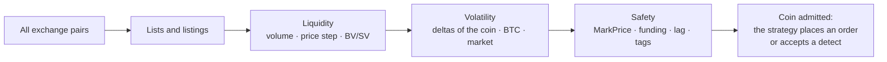
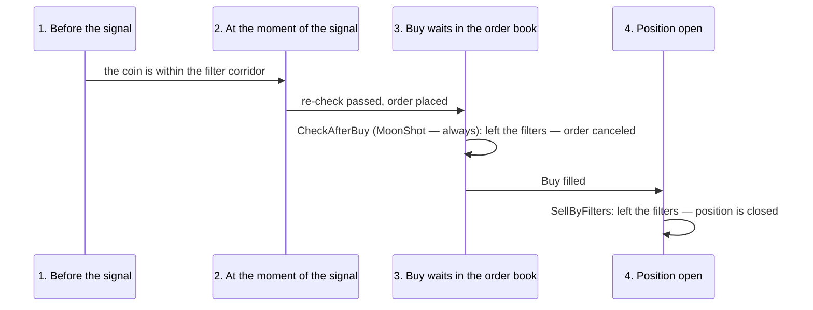

# 01. Coin selection for scalping and the market filter system

> **Official Moonbot documentation:** [“Markets Table” Overview](https://moonbot.pro/documentation/show-markets-button-and-marketstable-window/markets-table-overview) | [Trading Volume and Its Importance](https://moonbot.pro/education/basics-of-technical-analysis/trading-volume-and-its-importance) | [Documentation (full technical reference)](https://moonbot.pro/documentation)  
> **Related sections:** [02. Finding trading situations: detects and signals](02-detect-pipeline-and-signals.md) | [05. CustomEMA formulas](05-ema-geometry-and-formulas.md) | [06. Orders, take-profits and stops](06-orders-exits-and-stops-cascade.md) | [Reference: filter execution order](../reference/filter-execution-order.md) | [Archetype 02. Tiered MoonShot pack](../examples/strategies/02-moonshot-tiered-pack.md)

---

## 1. Why a strategy needs market context

Scalping lives on inefficiencies: a sharp price spike, a concentration of liquidity in the order book, a burst in the trade feed, a level breakout. But an impulse on the tick chart promises nothing by itself. The same one-second candle down on a liquid coin with a dense order book and a calm Bitcoin is a working spike that, as a rule, gets bought back within fractions of a second. The same candle on a coin with a coarse price step, against a cascading Bitcoin sell-off or a minute before the funding settlement, is more likely the start of a crash with no pullback, where a limit buy order brings a loss. A filter does not predict where the price will go; it selects the situations in which the strategy's bet makes sense.

The strategy itself does not see this difference: a detect looks for the shape of a move, not its meaning. Filters give it context. They answer one question: **out of hundreds of trading pairs, which ones is the strategy allowed to work on right now?** A coin passes selection on three criteria:

- **Liquidity**: can you enter and exit this pair quickly without slippage — trading volume, price step, the balance of buys and sells in the feed.
- **Volatility**: is there a move here worth trading, and is the coin overheated — the price deltas of the coin itself, of Bitcoin and of the whole market.
- **Safety**: is something structural happening to the coin that turns an ordinary impulse into a trap — a mark price desync, the funding window, exchange data lag, a fresh listing, a delisting warning.

Until a coin passes selection, the strategy places no orders on it and accepts no detects. How exactly, and at which moments of a trade, this is checked is covered in section 6.

### The Coins table: the screener already built into the terminal

For manual selection and preparing coin lists there is the **Coins table** window (`MarketsTable`, the **Show Markets** button). In real time it shows, for all pairs of the exchange, the same things the strategies filter by: daily and hourly volume, deltas over several windows, relative price step, order book depth near the price, funding, allowed position size. No separate external screener is needed: sort the table by the column you need, select the rows and copy the tickers to the clipboard (`Copy markets above selected`) — a ready white or black list for a strategy. The table is also convenient for choosing filter boundaries: you can see how many coins pass at a given value. For filters that look at several windows at once (the three-hour and daily deltas also take the hourly one into account), check the related columns rather than a single one.

---

## 2. Liquidity: volume, price step, feed balance, position size

The main job of this group is to let the strategy only into an order book where there is counter-liquidity both for the entry and for closing at the take-profit or the stop. A beautiful spike on an empty coin is worth nothing: the order will fill, and there will be nobody to exit to.

### Daily, hourly and minute volume

Volume is set in the pair's quote currency (for example, `USDT`), with the abbreviations `K` for thousands and `M` for millions. Four windows look at the same coin from different distances:

**Daily volume** (`MinVolume` / `MaxVolume`) is the basic liquidity tier. It separates coins where a market exists at all from “dead” pairs, and it barely changes over the course of a trade.

**Hourly volume: classic and fast.** The classic hourly volume (`MinHourlyVolume` / `MaxHourlyVolume`, `hv` on the chart) is built from closed five-minute candles. It has a blind spot: money poured into the coin during the current, not yet closed five-minute candle is not visible in it. From cases discussed in the chat: at the height of a pump, the classic hourly volume showed 0.2–0.3 million when 1–2 million had actually been traded in the coin over the last minutes — and for several more minutes the filter let through orders it should have stopped.

The fast hourly volume (`MinHourlyVolFast` / `MaxHourlyVolFast`, `Vf` on the chart) is computed directly from the trade feed and reacts instantly — as the stream is processed, with a delay of fractions of a second, without waiting for the candle to close. This works both ways: the `MaxHourlyVolFast` ceiling immediately stops entries into a coin where a pump has started, and the `MinHourlyVolFast` threshold immediately opens coins where turnover has just come alive. What the other filters say is a separate question; the fast volume has its say immediately. The `hv` and `Vf` boundaries are not interchangeable: the same number means different things, because the windows are computed differently — tune them separately. After the terminal starts, the fast volume needs time to build history: until it has one, the indicator may stay at zero, and a positive `MinHourlyVolFast` will keep the coin closed even though it is trading. This is not a filter failure but an absence of data.

**Minute volume delta** (`MinuteVolDeltaMin` / `MinuteVolDeltaMax`, `Vd1m` on the chart and in reports) is a dimensionless ratio of the last minute's turnover to the coin's reference average minute turnover. `1` means turnover equals that reference, `5` means five times the reference. It measures activity relative to that baseline, not the amount of money itself: the same threshold suits both a large and a small coin. The lower boundary catches the moment the coin wakes up; the upper one cuts off a coin that is already overheated.

> [!WARNING]
> **Where zero is a ceiling and where it means “off”.** In `MaxVolume` and `MaxHourlyVolume`, zero is read literally as a limit of `0` and blocks all coins; if you do not need a ceiling, set a deliberately large number. In `MaxHourlyVolFast`, `MinuteVolDeltaMax` and `MaxPosition`, zero means the opposite: “boundary disabled.” This is one of the most common reasons for “the strategy is silent across the whole market.”

### Price step: what one tick costs

High turnover does not guarantee an order book fit for scalping. The relative price step (`PriceStepMin` / `PriceStepMax`) shows what share of the price the minimum tick of the exchange grid makes up:

$$\text{PriceStep}\,(\%) = \frac{\text{TickSize}}{P_{\text{cur}}} \times 100\%$$

A coin at `0.0020` with a step of `0.0001` has a tick of `5%`: one step of the order book is larger than any reasonable take-profit, and the order can neither be placed precisely nor moved carefully. Compare the price step with your take-profit: if one tick is comparable to the target profit, this pair cannot be scalped, however lively it is. `PriceStepMin` works in the opposite direction — it cuts off a grid that is too fine, where liquidity is smeared across hundreds of levels. The step value for any pair is visible in the `PriceStep` column of the Coins table. The upper boundary is disabled with `PriceStepMax = 100`; zero, as with volume, blocks all coins.

### Who is the aggressor in the feed: `BV/SV`

The trade feed shows not only the price but also who is moving it. Every trade is someone's market order: a buyer took volume out of the red book, or a seller dumped into the green one. The amount of money taken by buyers (`BV`) against the amount taken by sellers (`SV`) over the last `BV_SV_TradesN` trades or seconds (which one to count is set by `BV_SV_Kind`) is `BV/SV`: above one, buyers are pressing; below, sellers.

The entry filter `UseBV_SV_Filter` admits a coin if buyers dominate by no less than `BV_SV_FilterRatio`: `2` means “over the window, at least twice as much was bought as sold.” The ceiling `BV_SV_FilterRatioMax` cuts off an overheated one-sided buyback, where everyone has already bought and there is nobody left to sell to. For `MoonShot` this entry filter does not apply — a shot does not go through the signal path. The entry filter always counts buyers against sellers, regardless of the strategy's direction and of `BV_SV_Reverse` — that parameter belongs to the `BV/SV` stop, which is described in [chapter 06](06-orders-exits-and-stops-cascade.md) and which, for a short, computes the fraction mirrored. The entry filter is checked at the moment of the signal, not in background selection, so its rejection is not visible in “Filters on charts” — the reason is written to the log.

### Position limit on a coin: `MaxPosition`

`MaxPosition` is the monetary ceiling of this bot's position on a coin: the open position plus active entry orders plus the new `OrderSize` must not exceed the limit, otherwise the new order is not placed, and with `CheckAfterBuy` enabled the entry orders already standing are canceled. This protects against overshooting volume on repeat entries and strategy links on the same asset. Zero disables the limit. Positions of other bots on the same account are not counted.

---

## 3. Coin volatility: deltas

A delta is the price move over a time window, in percent. It is used to select either coins that have been shaken up, for spikes and a wide spread, or, conversely, quiet coins in consolidation before the first impulse.

### Range and direction are two different things

The standard coin deltas (`Delta_3h_Min / Max`, `Delta_24h_Min / Max`, the `1m`, `5m`, `15m`, `30m`, `1h`, `2h` windows in the `Delta2` / `Delta3` slots) measure **range**: how much the window's high is above its low. Such a delta is always non-negative and does not know which way the price went:

- a coin rose from `70` to `100` — delta $(100/70 - 1) \times 100\% = +42.86\%$;
- a coin **fell** from `100` to `70` — high `100`, low `70`, the delta is the same `+42.86%`, although the fall from the top was `−30%`.

So a positive delta in the screener is not a sign of growth but a sign of movement. Direction comes from the **directional deltas**: `Pump5m` and `Pump1h` are the rise from the price at the start of the window to the window's high; `Dump1h` is the fall from the price at the start of the hour to the hour's low. They are also non-negative, but each looks in its own direction: if the coin only fell, `Pump5m` is zero. This is how you select a beaten-down market for catching a bounce (high `Dump1h`) or block entries into a falling knife. The directional deltas are available in the `Delta2` / `Delta3` slots (`Delta2_Type`, `Delta2_Min / Max`, and likewise for `Delta3`), in the universal `FilterBy` filter and in the sorting of dynamic lists.

The three-hour and daily delta filters also take the hourly delta into account: a fast hourly spike falls under `Delta_3h_Max` and `Delta_24h_Max` immediately, without waiting for it to show up in the large window.

> [!WARNING]
> **A zero delta ceiling does not disable the filter.** `Delta_3h_Max = 0` requires a delta of no more than zero and cuts off any live coin. To remove the restriction, set a wide boundary (`Delta_3h_Max = 1000`) or disable the whole group with `IgnoreDelta = YES`. The exception is the universal `FilterBy` filter: there, `FilterMin = 0` and `FilterMax = 0` really do disable the corresponding boundary.

### The universal `FilterBy` filter

Besides the fixed deltas, one line can impose `FilterMin` / `FilterMax` boundaries on any indicator from the sorting list: volumes over different windows, deltas, `Pump` / `Dump`, funding, mark price deviation. This is the tool for conditions that have no dedicated parameter — for example, to select only coins with an extreme funding rate or, conversely, to exclude them.

### The noise of single trades

On crypto exchanges, single small prints at the edge of a sparse order book slip through regularly. If the hourly delta were computed on every such tick, one ten-dollar trade would stretch the delta for the whole hour and throw off the aim of every strategy on the coin.

That is why, by default, the longer deltas are built on the smoothed price rather than on raw ticks: a single spike with no series of trades behind it does not enter the delta, while a real spike made of many trades shifts the smoothed line and is counted honestly. If a strategy is designed to collect single-tick spikes, the behavior is switched with the **Settings → Main → “Deltas include raw trades”** checkbox — then all trades in the feed enter the delta extremes. Old extremes are not cut off with a step at the window boundary but leave the calculation gradually: a protective filter releases the coin when it has really calmed down, not exactly by the clock.

### Hysteresis while an order is held: `DeltaSwitch`

While a strategy's order sits in the order book, the market keeps moving, and the coin may leave the delta boundary for a moment and come back. So that the order is not canceled and re-placed on every such jitter, while the order is held the delta boundaries widen by `±DeltaSwitch`: the coin is taken in the interval from `X` to `Y` and stays in work in the interval from `X − DeltaSwitch` to `Y + DeltaSwitch`. This matters for `MoonShot`, whose order sits in the order book permanently, and for any strategy with `CheckAfterBuy = YES`.

---

## 4. Market context: Bitcoin and the average altcoin delta

Altcoins rarely move on their own. When Bitcoin breaks into a sell-off or flies up in a vertical candle, correlation tends to one: market makers shift quotes on all pairs simultaneously, arbitrage robots dump or buy back baskets of assets. A local spike on an alt at such a moment is not an event of the coin but an echo of Bitcoin, and trading it like an ordinary pullback is dangerous.

### The bellwether's deltas: `Delta_BTC`

Bitcoin's deltas, unlike the coins', are **signed**. The hourly (`Delta_BTC_Min / Max`) and daily (`Delta_BTC_24_Min / Max`) show how far the current `BTC` price is above or below its average for the period: minus — Bitcoin is below the average, plus — above. One range sets both protections: the condition `Delta_BTC_Min = -0.8` and `Delta_BTC_Max = 0.8` lets spike strategies work only in a calm Bitcoin, blocking entries both on its crash and on its overheating.

The five-minute delta (`Delta_BTC_5m_Max`) is built differently, and not by accident. It is an **unsigned range** over the last minutes with protective inertia: a sharp Bitcoin price move instantly widens the range and turns the protection on, and after that move the range does not collapse in the same second Bitcoin stops — it releases gradually. A signed delta is no good here: if Bitcoin dropped within half a minute and bounced back just as fast, the “was — became” difference is about zero, and the filter would pretend nothing happened. Meanwhile, in the altcoin order books, secondary waves of liquidations are still running at that moment. The inertia of the range keeps strategies from returning to the market before it has calmed down.

### The average market delta: `Delta_Market`

`Delta_Market_Min / Max` and `Delta_Market_24_Min / Max` (`MAvg` in `CustomEMA` formulas) is the signed average deviation of price from its average across the exchange's traded altcoins. It is a way to separate the coin's own impulse from the general move: a coin rises `+3%` with the market near zero — it has its own large buyer; a coin falls `−3%` when the whole market is at `−2.5%` — this is not its event but a general sell-off, and the bounce will not depend on it.

If a coin fails the Bitcoin or market delta, `GlobalFilterPenalty` pauses the strategy for the set number of seconds — so that it does not switch on and off on every fluctuation of the context right at the boundary.

> [!NOTE]
> **Hyperliquid index markets (`HIP-3`).** On Hyperliquid's specialized venues, the `Delta_BTC*` filters and the `BTC(...)` formula measure not Bitcoin but the base index of the selected venue. The daily move of a stock index is an order of magnitude smaller than a crypto one, so the bellwether thresholds for such markets are set separately rather than copied from crypto strategies.

---

## 5. Dangerous market states

In round-the-clock autotrading the main risk is carried not by ordinary fluctuations but by structural events: funding settlement, a lagging mark price, a delay in the exchange data stream, the first minutes of a listing, a delisting warning. The filters of this group answer the question “is something happening with the coin that makes it better to skip the detect.”

### Futures: mark price deviation `MarkPrice`

On futures, liquidation and unrealized loss are computed not from the last trade but from the **mark price**, tied to the spot index. On a sharp squeeze the futures order book runs away from the mark, and a position opened at the market price can be liquidated at a price the trader never saw on the chart.

The `MarkPriceMin / MarkPriceMax` filter compares the mark's deviation from the market price — and the sign of the deviation is always read relative to **the direction of your trade**: plus — the mark has moved toward your liquidation (below the buy price for a long, above the sell price for a short), minus — toward the safe side (on a spike the market price flew ahead and the index lagged). So the same setting protects a long and a short equally. `MarkPriceMax` limits the dangerous side, `MarkPriceMin` the safe one; zero disables a boundary. Typical protection is `MarkPriceMin = 0`, `MarkPriceMax = 1`: do not place longs where the mark is a percent below the price, or shorts where it is a percent above. The filter belongs to the `Base` group and is disabled together with it (`IgnoreBase = YES`).

### Futures: windows around funding settlement

Funding is a payment between holders of long and short positions; by itself it does not move the price, but around the settlement moment, on coins with a large rate, the price often moves sharply: some close positions to avoid paying, others enter to collect the payout. The direction and size of this move are not known in advance. `FundingBefore` and `FundingAfter` (the `Filters → Time` tab, in seconds) set the behavior around this moment, and the meaning is determined by the **sign** of the number:

- **negative values — a protective pause:** do not work for the last `N` seconds before funding and the first `N` seconds after;
- **positive values — a funding hunt:** work **only** in the last `N` seconds before and the first `N` after, and stay silent the rest of the time.

| Moment relative to funding settlement | Pause (`FundingBefore = -300`, `FundingAfter = -60`) | Hunt (`FundingBefore = 300`, `FundingAfter = 60`) |
| :--- | :--- | :--- |
| 6 minutes before | allowed | blocked |
| 2 minutes before | blocked | allowed |
| 30 seconds after | blocked | allowed |
| 2 minutes after | allowed | blocked |

Both parameters work as a pair and only on futures; there is no funding on spot, and these checks are not performed. The size of the rate itself is filtered separately — `FilterBy = Funding` with the `FilterMin` / `FilterMax` boundaries.

### Exchange data lag and a jagged price pattern

Under peak load an exchange may execute orders on time but delay the public trade stream by hundreds of milliseconds and seconds. Trading on a chart that lags the market by a second means placing orders blind.

`MaxLatency` (the `Filters → Ping` tab) watches the actual lag of the stream — the difference between the trade time on the exchange and the time the terminal received it. When the threshold is exceeded, the strategy stops entries and takes a short protective pause until the stream catches up with the market. `MaxPing` limits the network ping to the exchange but works only with a non-zero `MaxLatency`; `MinPing`, conversely, forbids working when the ping is *too good* — for strategies designed for slow conditions — and does not depend on `MaxLatency`.

The divergence between the smoothed price line and the actual trades — the “price lag” — is measured by the terminal in percent. On the chart it looks like an unnatural jagged pattern: trades jump around the line they are supposed to follow. This is how an exchange gateway failure shows up (the phenomenon is characteristic of Binance; on other exchanges the same quantity is the deviation of trades from the order book quotes). Two parameters look at the lag from different sides. `BinancePriceBug` is protection: it relies on an exchange-wide anomaly indicator collected over several markets, and when it is exceeded it pauses **the whole strategy**, not one coin; the pause is extended if the failures repeat. `BinancePriceBugMin` is selection: it checks the lag of a specific coin and takes into work **only** those where it is greater than the set value — what is a sign of failure for protection is a radar for the spike hunter. These are two different indicators, not the boundaries of one, and they are not set together: every coin that fails `BinancePriceBugMin` triggers the same strategy pause as `BinancePriceBug` — a strategy with both thresholds barely trades.

### Listings: the first minutes of a pair's life

`DontTradeListing` forbids the strategy to trade a recently appeared pair for the set number of seconds — until the coin has built up history and an order book structure. `OnlyNewListing` works the other way around: it allows trading the pair **only** for the first `N` seconds after it appears. Together they cut out a window: `DontTradeListing = 10` and `OnlyNewListing = 60` — from the tenth to the sixtieth second. Neither filter is disabled by `IgnoreFilters = YES`. But trading listings needs one more condition outside the strategy: the terminal's global **“Dont buy newly added coins”** slider (Settings → Main, 60 minutes by default) acts on the signal path for all strategies except the `NewListing` type, and `IgnoreFilters` does not lift it. Set this slider to zero and set the pair's age in the strategy itself via `DontTradeListing` / `OnlyNewListing` — otherwise the listing strategy will sit silent for the first hour.

An important boundary: the terminal estimates the pair's age itself — by the moment the pair appeared in its market list, and after a restart by the available candle history. Until the history is loaded or while it is incomplete, the estimate may differ from the actual listing date, and in the first minutes after a restart it is better not to rely on these filters.

### Exchange tags: `BinanceTokenTags`

The exchange marks coins with risk and category labels (`Monitoring`, `Seed`, `Alpha`, `New`, `Launch`, `Fan`, `Gaming`, `TradFi`, `OICapped` and others). `BinanceTokenTags` selects coins by these labels: space-separated enumeration means “and”, a `!` sign before a tag means “without this tag”. The entry `!Monitoring !Seed !Alpha` on one line removes from work the coins under threat of spot delisting and experimental assets. A word unknown to the terminal in this field causes no error — it is silently ignored, so a typo in a tag looks like an absent filter. On futures contracts the exchange does not always set the spot `Monitoring` tag before removing a pair, so for futures the delisting protection is supplemented with the `MoonNews` news guard ([chapter 02](02-detect-pipeline-and-signals.md), [chapter 04](04-triggers-and-master-slave.md)).

### White and black lists with masks

`CoinsWhiteList` restricts the strategy to the listed coins, `CoinsBlackList` excludes the listed ones. Tickers are separated by commas or spaces; case does not matter. The `*` symbol at the start or end of a ticker sets a mask: `CoinsBlackList = *3L,*3S,*5L,*5S,*UP,*DOWN` on one line excludes all leveraged tokens, `1000*` picks out index contracts of the `1000PEPE` kind. A mask cuts by letters, not by meaning: `*UP`, together with the leveraged tokens, will also exclude `JUP` — check the mask against the Coins table before trusting it with a list. Masks work specifically in strategy lists, not in the global black list of the terminal settings.

### Dynamic lists: `DynWL` and `DynBL`

Instead of rewriting lists by hand, a strategy can rebuild them itself from the live market. Once every `Dyn_Refresh` seconds the terminal sorts all pairs by the selected indicator (`DynWL_SortBy` / `DynBL_SortBy` — any indicator of the Coins table: minute, hourly and daily volumes, deltas from a minute to three hours, `Pump5m` / `Pump1h` / `Dump1h`, funding, mark deviation, leverage and others), applies the strategy's filters to the sorted list, then subtracts the dynamic black list — `DynBL_Count` coins by its own criterion `DynBL_SortBy` — and from the rest takes the `DynWL_Count` best by `DynWL_SortBy`. This is the strategy's working list until the next recalculation. By default the recalculation runs about once a minute; recalculating too often loads the processor noticeably and causes frequent order re-placements.

One diagnostic peculiarity: if a coin did not make it into the dynamic list, “Filters on charts” will show only `Market XRP doesnt match strategy Dynamic white list`, without naming the reason. And there are two reasons: the coin did not make the selected count by the sorting criterion — or it failed the strategy's filters, which the list is built with. Filters that are too strict empty the dynamic list just as a `DynWL_Count` that is too small does.

---

## 6. How filters live through a trade

Filters are not a one-time check before entry. They accompany the trade at four moments, and each moment has its own parameters.

**1. Before the signal.** `MoonShot`, which keeps its order in the order book in advance, checks the filters continuously: the coin must stay within the corridor the whole time the order is standing. The `EMA` strategy continuously checks its condition and the filters before the signal. Signal detects (`Pump`, `Drops`, `Volumes`, `Spread`, `MoonHook`, `MoonStrike` and others) check the filters at the moment the impulse is detected. This is the stage that “Filters on charts” shows.

**2. At the moment of the signal.** Right before the order is sent, the filters are checked once more — while the spike was forming, the coin may have left the corridor. `DontCheckBeforeBuy = YES` skips this re-check for speed in fast detects and external signals (`Manual`, `Telegram`, `UDP`); checks that depend on the direction of the already determined signal (mark deviation for a long or short, balance and minimum lot) are performed in any case. Rejections at this stage do not get into “Filters on charts” — they are written to the log `logs/LOG_YYYY-MM-DD.log`.

**3. While the buy order waits in the order book.** `CheckAfterBuy = YES` keeps checking the filters the whole time the order is unfilled: if the coin left the corridor (allowing for the `DeltaSwitch` hysteresis), the order is canceled. For `MoonShot` this check is always on, regardless of the checkbox. With `CheckAfterBuy = NO`, an order placed after a detect hangs until it fills or until `AutoCancelBuy` expires, even if Bitcoin crashed in the meantime. `AutoCancelBuy` cancels an unfilled order after the set number of seconds (zero — do not cancel; for `MoonShot` no less than fifteen seconds); moving the order restarts the countdown, except for shot strategies.

**4. Position open.** `SellByFilters = N` turns the filters into an evacuation system: `N` seconds after the buy, if the coin has stopped passing the filters, the position is closed. This works independently of `CheckAfterBuy`. The position is closed not only by market filters but also by the pauses of the `Time` group: a third loss in a row on the coin (`PenaltyTime`, on by default), a losing trade by any strategy (`TradePenaltyTime`), a manual cancel or a click on the chart, as well as feed lag and a price failure. The schedule and funding windows do not lead to closing. The `CustomEMA` formula does not take part in this check — a formula exit is set separately, in `SellByCustomEMA` ([chapter 05](05-ema-geometry-and-formulas.md)). `SellByFiltersDelay` softens the exit: on the first violation the take-profit is moved once to the current price (no lower than `PriceDownAllowedDrop` from the entry) and a countdown starts; if the position has not closed in that time, forced closing kicks in ([chapter 06](06-orders-exits-and-stops-cascade.md)). The countdown is not reset even if the filter returned to normal in the meantime.

### What `IgnoreFilters` disables and what it does not

On the `Filters` tab there is the general `IgnoreFilters` switch and separate group switches — `IgnoreBase`, `IgnoreTime`, `IgnorePrice`, `IgnorePing`, `IgnoreVolume`, `IgnoreDelta`; a group's state is visible by the colored bar to the left of the section. The strategy schedule (`WorkingTime`, `WorkingWeekTime`) belongs to the `Time` group. `IgnoreFilters = YES` disables all six groups at once, and with them the `CustomEMA` entry filter. The terminal's global prohibitions “Dont buy newly added coins” and “Dont buy delisted coins” it **does not lift** for detect signals, `Telegram`, `UDP` and alerts — these are terminal settings, not strategy settings.

But some conditions lie outside these groups and are not covered by `IgnoreFilters`:

| What keeps working with `IgnoreFilters = YES` | What controls it |
| :--- | :--- |
| The strategy's white and black lists, the global black list, dynamic lists | only the lists themselves |
| Triggers (`TriggerByKey`, `TriggerKeysBL`, `SellByTriggerBL`) | the `Triggers` tab ([chapter 04](04-triggers-and-master-slave.md)) |
| Session limits and pause (`SessionStratMin / Max`, `SessionPenaltyTime`) | only `IgnoreSession = YES` |
| Remote strategy stop (`PreventWorkingUntil` by the `sgStop` command) | lifting the command |
| `OnlyNewListing`, `DontTradeListing` | the values of the parameters themselves |
| `LeveragedTokens`, `ListedType` | the values of the parameters themselves (not disabled by `IgnoreBase` either) |
| Exchange quarantines — the Gate.io order limit, Binance Futures quantitative rules | the exchange; for Gate — `IgnoreGatePenalty = YES` |
| The `SellByCustomEMA` check before entry (`SellEMACheckEnter`) | the `Sell` tab |

A separate case is a strategy with `SignalType = EMA`: `IgnoreFilters = YES` disables its general filter groups, but its detector checks the `CustomEMA` formula itself and keeps checking it. For other strategy types, the entry `CustomEMA` is skipped with `IgnoreFilters = YES` or `IgnoreBase = YES` — do not enable these flags in strategies where the formula is the entry condition; disable only the unneeded neighboring groups.

### Penalties: a pause after a failure

Filters say where you may work; penalties say when to stay quiet on a coin after an event. Four pauses with different scope:

- `PenaltyTime` — the strategy does not work on a coin where three losing trades went through in a row, or where an order was canceled or placed manually. The loss counter is shared by the terminal per coin. For `MoonShot` there is also a flip side: it tends to re-take coins that recently had a profitable trade.
- `TradePenaltyTime` — a pause after one losing trade on the coin by any strategy, including manual.
- `GlobalDetectPenalty` — any detect by any strategy puts a shared timestamp on the coin; a strategy with a non-zero `GlobalDetectPenalty` does not fire on this coin for the set number of seconds after such a mark, including its own detect. Strategies with zero do not notice the mark and enter as usual — so the pause is set on the strategy that needs to be held back, not on the one that fired first.
- `NextDetectPenalty` — the same strategy does not fire again on the same coin for the set time.

For the first two, whether a trade is a loss is determined by the price move, not by the net result including the fee: a trade closed at a penny plus by price does not enter the loss counter, although after the fee it may have been a loss. The first three pauses belong to the `Time` group and are disabled together with it. `NextDetectPenalty` stands apart: for the `Telegram`, `Combo`, `EMA`, `Spread`, `ChartWall`, `MoonHook` and `Activity` strategies it is lifted by the general `IgnoreFilters = YES` (for `Watcher` the pause is also checked inside the detect itself, so it is not lifted); for the other types it is checked inside the detect itself and is not disabled at all.

The `WorkingTime` schedule format accepts `hours:minutes - hours:minutes`; an entry `minutes - minutes` without hours sets a window inside **every hour**, not a daily interval.

### “Filters on charts”: why the strategy is silent

If the strategy is enabled, there is movement in the market, and there are no orders, do not go through the parameters at random:

1. Press the **“Filters on charts”** button (funnel icon, `Show Filters`) above the chart.
2. Right-click “Filters on charts” to choose what to display: the reasons for failing the filters, sessions (`Show Sessions`), the `MoonShot` price corridor (`Show MoonShot price corridor`).
3. Open the coin's chart: next to the name of each active strategy the terminal prints the reason that is keeping it from entering right now — for example, `3h delta (14.20%) doesnt match strategy range (0.00% .. 10.00%)` or `Market XRP doesnt match strategy white list`. When the list is long, the lines scroll with `Alt + mouse wheel`.

“Filters on charts” shows **one** reason — the first in check order on which the coin was cut off. Once you remove it, you may see the next one: this is normal, the check goes from top to bottom to the first rejection. If the strategy has disappeared from “Filters on charts” but there are still no orders, the reason is at the signal stage — look at the log. The full order of checks is in the reference [`filter-execution-order.md`](../reference/filter-execution-order.md).
