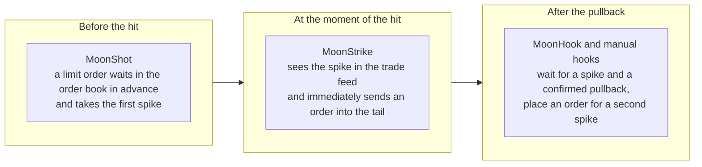

# 03. Spike hunting: MoonShot, MoonHook, manual hooks, MoonStrike and SellShot

> **Official Moonbot documentation:** [MoonShot Strategy and Its Parameters](https://moonbot.pro/documentation/advanced-strategy-parameters/moonshot-strategy-and-its-parameters) | [MoonHook Strategy and Its Parameters](https://moonbot.pro/documentation/advanced-strategy-parameters/moonhook-strategy-and-its-parameters) | [MoonStrike Strategy and Its Parameters](https://moonbot.pro/documentation/advanced-strategy-parameters/moonstrike-strategy-and-its-parameters) | [“Sell order → SellShot” Tab](https://moonbot.pro/documentation/sell-order-tab/sell-order-sellshot-tab) | [Manual Strategy and Its Parameters](https://moonbot.pro/documentation/advanced-strategy-parameters/manual-strategy-and-its-parameters) | [Features of Futures Trading](https://moonbot.pro/documentation/futures-trading/features-of-futures-trading)  
> **Related sections:** [01. Coin selection and the filter system](01-market-selection-and-filters.md) | [02. Detects and signals](02-detect-pipeline-and-signals.md) | [06. Orders, take-profits and stops](06-orders-exits-and-stops-cascade.md) | [Reference: MoonShot, MoonHook, MoonStrike parameters](../reference/params/02-detectors-and-signals.md) | [Archetype 02. Tiered MoonShot pack](../examples/strategies/02-moonshot-tiered-pack.md) | [Archetype 03. Standalone MoonHook and manual hooks](../examples/strategies/03-moonhook-and-manual-combo.md)

---

## 1. The spike: what it is and why it is taken three ways

Liquidity in the order book is distributed unevenly. When a large market order, a cascade of stop losses or an exchange liquidation eats through the nearest levels, the price on the tick chart draws a vertical arrow — a **spike** — and, as soon as the one-off volume is exhausted, market makers and arbitrage robots fill the void, and the price most often springs back. By hand you cannot make it at such a moment: the peak lives shorter than a human reacts. For spikes, Moonbot has three strategies, and each works on its own phase of the impulse:

| | **`MoonShot`** | **`MoonHook`** | **`MoonStrike`** |
| :--- | :--- | :--- | :--- |
| **What it takes** | The first spike: the order is already in the exchange's book before the hit | A second spike after the first spike and pullback | The tail of the spike at the moment of the hit, while the spike is still flying |
| **In a calm market** | The order sits in the order book and is moved after the price — spends API limits and holds margin | No orders: the strategy only computes the feed | No orders: the strategy only watches the trade stream |
| **What limits coverage** | The number of simultaneous orders and the capital: every order is real | The processor: recomputing the feed for all coins costs resources | The speed of the channel to the exchange: a strike is a race against other bots |
| **Main risk** | A crash with no pullback fills a close limit order | An order under a fading wave or a breakdown of the second bottom | An entry in the middle of an unfinished dump |
| **How it is protected** | The `MShotAdd*` depth adjustments, coin, market and `BTC` filters — the shot cancels the limit order as soon as the coin leaves the filters | The `HookPriceRollBack` pullback, `HookAntiPump`, a negative `BuyModifier`, `BuyOrderReduce` order size reduction | The `MStrikeVolume` volume, `MStrikeWaitDip` waiting for the first trade against the move, volatility adjustments |
| **Access** | Available in Free and PRO | PRO with MoonBonus | A separate paid strategy |

A repeat shot (`MShotRepeat*`) requires the **Autotrading** module: without it these conditions are silently skipped.

---

## 2. MoonShot: a trap set in advance

`MoonShot` detects nothing: the coins are selected by the strategy's filters ([chapter 01](01-market-selection-and-filters.md)), and on every selected coin the order simply sits in the order book at the set depth and moves along after the price. While the market breathes evenly, the order waits; a spike fills it — and that is the trade.

### The MoonShot corridor: where the order sits and when it moves

`MShotPrice` is the distance from the current price at which the order is placed (in percent; below the price for a long, above for a short). `MShotPriceMin` is the near boundary: how close the price may come to the order before it goes deeper. The far boundary is built automatically — at the smaller of two numbers: `MShotPriceMin` and the difference `MShotPrice − MShotPriceMin`. The result is a corridor around the order in which the price moves without touching it:

- `MShotPrice = 3`, `MShotPriceMin = 2`: the order is 3% below the price, the corridor is 2…4%. The price came closer than 2% — the order goes down to 3% again. The price went up so that the order ended up deeper than 4% — the order is pulled up.
- The defaults `7` and `2`: a corridor of 2…9%.

The boundaries are visible on the chart: right-click **“Filters on charts”** (funnel icon) → `Show MoonShot price corridor`. The wider the corridor, the rarer the re-placements and the more economical the use of API limits; the narrower, the more precisely the order keeps its distance. A mistaken `MShotPriceMin > MShotPrice` turns the corridor into a line on save: `MShotPrice` is raised to `MShotPriceMin + 0.001`, and the order is re-placed continuously.

### Which price to count from: `MShotUsePrice`

`Trade` is the recommended mode: for a long, the **worse** of two prices is taken — the last trades and the best bid (in a short — the ask). So it sees both a print that pierced the book and the disappearance of buyers below the price. `BID` and `ASK` look only at the order book and do not see trades through it; `ASK` holds the order higher on a brief spread widening without trades. If the feed is stale, in `Trade` mode the order is counted from the order book — from the bid in a long, from the ask in a short. In the strategy text `ASK` is written in capitals, `Trade` in any case; any other spelling (for example, `Ask`) is silently read as `BID`.

`MShotMinusSatoshi = YES` keeps the limit order from standing flush against the reference price. This is for coins with a coarse grid, where one price step is already a percent or more: without the offset, an order on such a coin stands effectively at market.

### Volatility adjustments: the order goes deeper by itself

A fixed depth that is safe in a sleeping market becomes dangerous when the coin or Bitcoin starts moving. `MShotAdd*` deepen the order in proportion to the current deltas, and there is no need to rewrite `MShotPrice` by hand:

$$\Delta_{\text{add}} = \min\!\Big(\text{MaxModifier},\; \sum k_i \cdot \Delta_i\Big)$$

- `MShotAdd1minDelta`, `MShotAdd5minDelta`, `MShotAdd15minDelta`, `MShotAddHourlyDelta`, `MShotAdd3hDelta`, `MShotAdd24hDelta`, `MShotAdd5sDelta` — the coin's own volatility over its window; `MShotAddMarketDelta`, `MShotAddBTCDelta`, `MShotAddBTC5mDelta` — the market and Bitcoin context; `MShotAddArbRange` — the cross-exchange price spread; `MShotAddPriceBug` — exchange lag (contribution capped); `MShotAddMarkDelta` — the mark price deviation on futures.
- All terms are non-negative: the coin's deltas measure range, the market and `BTC` deltas are taken in absolute value. Any volatility — rise or fall — only deepens the order. There is one exception: `MShotAddMarkDelta` works only when the mark has deviated toward your order. `MaxModifier` caps the sum from above (`0` — no cap).

An example from the terminal tooltip: `MShotPrice = 10`, `MShotAdd3hDelta = 0.05`, a three-hour delta of `20%` — the order will stand not at `−10%` but at `−11%`, and will move together with the delta.

**`MShotAddDistance`** shifts the order itself (and with it the far boundary of the corridor) more than the near boundary. If an adjustment shifted the near boundary by `X%`, the order shifts by `X · (1 + MShotAddDistance / 100)`:

$$P_{\text{min}} = \text{MShotPriceMin} + \Delta_{\text{add}}, \qquad P_{\text{order}} = \text{MShotPrice} + \Delta_{\text{add}} \cdot \left(1 + \frac{\text{MShotAddDistance}}{100}\right)$$

With `MShotAddDistance = 100` the order moves away twice as much: in a calm market the order stands guard in a narrow corridor; on a burst it goes deeper and stops twitching. The site recommends `MShotAddDistance = 50` for short corridors (boundary difference up to `0.5%`) together with `MShotUsePrice = Trade`.

Do not confuse this with the neighboring `Delta Modifiers` tab: there, `SellModifier` and `StopLossModifier` shift the take-profit and the first stop once, at the moment of purchase, while `MShotAdd*` move the order itself the whole time it stands.

### Two delays and the fast algorithm

**`MShotReplaceDelay`** is the pause before moving the order deeper when the price has come closer than `MShotPriceMin`. This is not protection but a compromise: with zero, the order manages to escape from under a fast but not instant spike — there will be no trade; with a delay, the spike fills the limit order, but a smooth slide also fills it more often. The terminal tooltip names values of the order of `0.032–0.064` s for mid-range shots designed for a series of two or three hits in a row. If the price returned to the corridor during the pause, the countdown is reset.

**`MShotRaiseWait`** is the pause before pulling the order up closer to a price that has moved away, and it has two roles. The first is protection against a counter-move: after a vertical burst upward the price often flies right back, and an order that jumped after the top of the candle takes a counter hit. The second is **memory depth**: the same seconds set the window in which the terminal looks for the price low (in a short — the high) and uses it as the reference for `MShotPrice`. A new strategy starts with `30` seconds: until the low of the last half minute moves up, the order will not follow the price. Minutes in this parameter glue the order to a bottom passed long ago — and on a re-placement downward the order distance will also be measured from the old low, deeper still. Any re-placement resets the countdown.

**`FastShotAlgo = YES`** (enabled by default; disabling is kept for compatibility) changes which price the shot considers “current”. With a non-zero `MShotRaiseWait`, the deepest trade of the last instant is taken rather than the last one in the batch: the exchange sends trades in batches, and the last one may turn out to be at the top of the spike even though the lower print has already pierced the boundary. `MShotRaiseWait = 0.01` is enough to enable this mode without changing the trading; at zero, the first, simple variant without extreme holding works. The second consequence: the take-profit is placed immediately upon the fill. Re-placements should be slowed down not by clearing the checkbox but with `MShotReplaceDelay`. The same mode also applies to `MoonHook` orders. For strategies designed around the former slow take-profit placement (a take-profit flush with the entry or below), an instant take-profit may close the trade inside the same spike: a small `SellDelay` lets the price bounce.

### The shot's take-profit: exiting into the middle of the bar

By default `MShotSellAtLastPrice = YES`: after the buy, the take-profit is placed at the **greater** of two prices — the strategy's `SellPrice` and the sell price as it was before the spike (the ask a few seconds before the hit), less `MShotSellPriceAdjust`. The idea is to sell on the return to the price the coin was torn from, not at a percent from the bottom. `SellPrice` works as a lower bound here; if you need a fixed take-profit in percent — `MShotSellAtLastPrice = NO`. An example from the tooltip: the ask before the spike `1000`, adjustment `1%` — the second price is `990`.

### How many shots, which coins, and why “limit orders are not placed”

- Without the **“Unlimited orders”** checkbox, the terminal holds no more than **30** simultaneous shots (the limit also includes the scouts' virtual orders); the checkbox lets you set more in the `Max Orders` field — with a warning about the risk of an exchange ban; the limit is shared by all strategies of the terminal. The site advises keeping fewer than `30–35` active orders per API key, and when that is not enough — splitting the shots between keys, sub-accounts and servers.
- Coins are taken like this: first the one that recently had a profitable trade (within `PenaltyTime` — for shots this pause also works as “stick to the lucky coin”), then the rest by `MShotSortBy` / `MShotSortDesc` — deltas, volumes, `Pump` / `Dump`, funding, leverage, `MaxOrder`, and for `MoonStrike` owners also `OrderBook` (the thinnest order books first). A coin with a closed chart gets no order when sorting by order book: its order book is not loaded.
- Filters are checked the whole time the order stands, with the `DeltaSwitch` tolerance — hence the “blinking” shots: the coin left the filter, the limit order was canceled.
- `AutoCancelBuy` for a shot is no less than `15` seconds and works as a periodic reshuffling of coins; a small random spread is added to the term so that orders are not canceled in one batch.
- When the API or the processor is overloaded, the strategy skips a turn (`API or CPU overload` in the log) — a frequent answer to the question “why are shots not being placed”.

### A repeat shot after a buy (Autotrading module)

`MShotRepeatAfterBuy = YES` allows placing the next shot on the same coin without waiting for the first trade to close. The check runs in a window from `MShotRepeatDelay` to `MShotRepeatWait` seconds after the take-profit is placed, and the condition is two-sided: the price is above the entry by `MShotRepeatIfProfit` — a repeat following the move; the price is below the entry by `MShotRepeatIfDrop` (negative values only; `0` — any price below) — a repeat as **averaging** into a falling coin. The falling branch is always on when the repeat is on. The repeat shot takes the same coin out of turn and is not counted in `MaxActiveOrders`. This is a repeat **entry**, not an exit: account for the doubled volume when you choose the stop.

---

## 3. MoonHook: entering on the pullback after a spike

`MoonHook` holds no orders in a calm market and can therefore watch all coins of the exchange without spending API limits. It steps in when the spike **has already happened** and the price has started to be bought back: large spikes often repeat, with the price returning to the same zone, and the order is placed inside the tail of the candle that flew by, for the second spike. The conditions are recomputed per cycle, not on every trade, so the hook does not take the first spike by design — `MoonShot` and `MoonStrike` are responsible for it. The strategy is available in PRO with MoonBonus and loads the processor noticeably: when power runs short, the log shows `Some detection calls are missed… use more powerful VPS`.

### What counts as a spike

1. **The `HookTimeFrame` window** (`0.4…10` s, default `2`) is counted back from the last trade. A repeat detect on the same coin in the same direction is possible no sooner than about `HookTimeFrame` plus a second.
2. **Volume and depth.** `HookDetectMinVolume` — the minimum turnover required within the window to confirm the spike (it is also needed for signal-only hooks without auto-buy, where order size reduction does not work). The depth of the move — no less than `HookDetectDepth` plus the `DetectModifier` volatility increment, and no more than `HookDetectDepthMax` (`0` — no ceiling). The ceiling is not shifted by the modifier: in a shaken-up market the rising lower threshold may catch up with the upper one, and detects will stop.
3. **Is this a pump?** `HookAntiPump = YES` counts a spike only if before it, for several windows in a row, the price held above the bottom by no less than the detect depth; a return to the former level after a short burst upward does not qualify. `HookDropMin` / `HookDropMax` look at how much the coin had already fallen over roughly the last half minute before the spike, in percent of the spike's own depth: `200` — the preceding fall is twice the spike.
4. **The pullback.** After the bottom, the price must return by more than `HookPriceRollBack` percent of the depth (measured by the highest price after the bottom), but no more than `HookPriceRollBackMax` (`0` — no limit). `HookRollBackWait` in milliseconds requires the pullback to hold, and filters out a single trade in the spread; the whole event — spike, pullback and wait — must fit within `HookTimeFrame`.

Direction is set by `HookDirection` (`OnlyLong` — downward spikes, `OnlyShort` — upward, `Both` — both, long checked first); `HookOppositeOrder = YES` places the order against the spike — in continuation of the breakout.

### Where the first order goes: `HookInterpolate` and `HookInitialPrice`

Let the price fall from `110` to `100` (depth `10%`) and pull back to `105`. `HookInitialPrice` sets the first placement of the order, and `HookInterpolate` what to count it from:

| Mode | Counted from | Example with `HookInitialPrice = 25` | What for |
| :--- | :--- | :--- | :--- |
| `0` | From the bottom upward by a fraction of the spike depth | `100 + 25% · 10 = 102.5`; if this is above the tracking corridor from the current price (section below), the order goes to its upper boundary | The classic: the order aims at a set part of the bar that flew by |
| `1` | From the pullback price downward by the same relative fraction | On a weak pullback the order goes below the bottom, on a strong one inside the tail | Anchoring to the actual pullback |
| `2` | Like `0`, but the corridor is fitted to the order, not the order to the corridor | The `102.5` level is kept; if it is above the current price, the signal is skipped | `HookInitialPrice` also sets the minimum pullback: at `45`, entry is possible only when the price has returned by more than `45%` of the spike |
| `3` | From the current price downward on an **inverted scale** by a fraction `(100 − HookInitialPrice)%` of the depth | At `70` — about `2.9%` below the price, at `30` — about `6.5%` below | The offset is proportional to the spike depth |
| `4` | The same, but as a fraction of the **pullback** | At `50` — roughly in the middle of the pullback | The offset is proportional to how much the price has already given back |

In modes `3` and `4` the scale is inverted: `100` — right at the price, `0` — a whole depth (mode `3`) or the whole pullback (mode `4`) below, negative values — deeper still. The smaller the number, the deeper the order.

### Where the order moves afterwards: the hook corridor

After the first re-placement, the order lives in a corridor and is tracked after the price, like a shot. In modes `0` and `1`, `HookInitialPrice` sets only the first placement — after that the order stands one spike depth from the price, and `HookPriceDistance` sets the corridor width in percent of this depth: a `5%` spike, `HookPriceDistance = 10` — a corridor of `4.5…5.5%` below the price. In modes `2…4` the order keeps its initial distance to the price, and the corridor is built around it. `HookPriceDistance = 0` — the order stands still until filled or canceled. Re-placements go through `HookReplaceDelay` (deeper) and `HookRaiseWait` (closer); `HookRaiseWait`, like the shot's, has a second role — the extreme search window, and the starting `30` seconds keep the order under the old bottom.

**A negative `BuyModifier`** on the hook works differently than in other strategies: it does not shift the initial price but widens the corridor when volatility grows after the detect. The increase in the sum of modifiers is multiplied by `|BuyModifier|`; the lower boundary goes deeper by this amount, the upper by half as much. An example from the site: at the detect the modifiers gave `10`, then grew to `50`, `BuyModifier = −3`, coefficient `0.05`: the corridor `−2…−3%` becomes `−5…−9%`. The order will move at the next re-placement. A positive `BuyModifier` has no effect on the hook.

### Order size to match the spike's liquidity

Available order book liquidity can differ by tens of times between coins; entering a thin spike with a full working order means buying out the book yourself and being left without an exit. `BuyOrderReduce` (in milliseconds) estimates the average trade turnover over this time inside the `HookTimeFrame` detect window (since version 7.71; before that — by `TimeInterval`) and reduces the order to this estimate, no lower than the exchange minimum. `MinReducedSize` is the threshold: if the estimate is lower, there is no detect at all. The fact of reduction is visible in the log by the line `Buy order reduced` with the new size and the estimated turnover. A manual hook is not reduced. And the arithmetic: what is compared is not the turnover of the whole window but its share over `BuyOrderReduce` milliseconds — window turnover × `BuyOrderReduce` / `HookTimeFrame` (bring milliseconds and seconds to the same units). With a turnover of `1000 USDT` over a two-second window and `BuyOrderReduce = 100`, the estimate is `50 USDT`: the `HookDetectMinVolume` threshold is passed, yet the order is still reduced.

### Take-profit and re-arm

The hook's take-profit is counted from the spike depth, not from `SellPrice`: `HookSellLevel` is a fraction of the depth. With `HookSellFixed = NO`, the fraction is counted from the distance between the calculated entry price and the top from which the spike started: `100` — a sell at the top (if the entry went through at the calculated price). With `HookSellFixed = YES`, `HookSellLevel` percent of the depth is added to the **actual** entry price regardless of where inside the spike the order filled: an entry at `104.5` on a `110 → 100` spike with `HookSellLevel = 55` gives a take-profit of about `110.2` — a full return, not half the spike. `HookPartFilledDelay` (ms) gives a partially filled order time to complete before the remainder is canceled.

`HookRepeatAfterSell = YES` re-arms the hook after the trade closes if its profit is **strictly greater** than `HookRepeatIfProfit`: `0` — any profitable trade; a zero or losing one gives no repeat. The way of closing does not matter; with an order grid, one order is re-placed, not the grid.

---

## 4. Manual hooks (“Manual MoonHook”): the trader's eye plus tracking

You see a coin with live spikes on the chart and understand at what depth to catch, but moving a limit order after a running price by hand is impossible. A manual hook is a link of the `Manual` strategy and `MoonHook`: you click into the order book, the order is handed over to the hook's control, it tracks it in the corridor, after the fill places a take-profit from the click depth and, if allowed, re-arms the hook at the same distance. How it is assembled:

1. **The slave `MoonHook`.** Set the corridor width `HookPriceDistance` (without it the manual hook does not work), the delays `HookReplaceDelay` / `HookRaiseWait`, the take-profit `HookSellLevel`, the stops and the line color. It does not need the detect parameters — it detects nothing.
2. **The `Manual` strategy.** On the `Strategy settings` tab, in the `UseHookStrategy` field, select the slave. On save, the terminal switches it to slave mode: enables `AutoBuy`, zeroes `OrderSize`, clears the start checkbox.
3. **Enable the manual strategy.** `Menu → Manual Trading → Use Manual Strategy`, then select the needed `Manual` — by name above the chart or with a button; buttons and hotkeys are configured in `Settings → Hotkeys → Manual Strategies`.
4. **Click into the order book.** An order with a green corridor bar appears at the chosen depth. The distance is counted from the live price, and when there are no trades — from the order book. The corridor is proportional to the click depth: the farther the order, the wider the corridor and the rarer the re-placements. The take-profit scales from the click depth and `HookSellLevel`: the deeper you caught, the higher the take-profit.

What matters to know: a manual hook works even with `Autodetect` off and without checkboxes on the strategies; its lifetime is the slave's `AutoCancelBuy` (`0` — until filled or manually canceled); when the terminal closes, manual hooks are removed from the exchange. The slave's filters also apply: a coin from its black list — the order will be placed and immediately canceled. So the filters are kept in `Manual`, and the slave gets `IgnoreFilters = YES`, after checking its coin lists. `HookRepeatAfterSell` is read from the slave: after a profitable take-profit, the next hook goes at the same percentage distance without your involvement.

---

## 5. MoonStrike: an order at the moment of the hit

If `MoonHook` waits for the spike to complete, `MoonStrike` fires **inside** it — right in the trade stream, without waiting for background cycles. The reference is an internal bid line that, on a fall, drops after the price immediately and, on a rise, climbs smoothly; the depth is measured from it to the spike's low. This is a race against other bots: the site recommends a server in Tokyo and running the terminal as administrator (elevated process priority). Smoothing of the reference line (`MoonStrikePriceSmooth` in `MoonBot.ini`) is on by default; without it, false “dragging” strikes appear.

**What the strike will not fire without.** `AutoBuy = YES` and an explicit `OrderSize > 0` are needed — otherwise there is no detect at all, not even a notification. `MaxActiveOrders` here is shared by all strike strategies of the terminal (`0` — no limit). Anti-spam is `NextDetectPenalty`. The strategy has no general `buyPrice` and `SellPrice` — it has its own levels instead.

**Detect.** A print breaks through the reference line by `MStrikeDepth` percent (on spot from `0.1%`, on futures from `0.01%`) plus the `MStrikeAdd15minDelta`, `MStrikeAddHourlyDelta`, `MStrikeAddMarketDelta`, `MStrikeAddBTCDelta` adjustments, and the money volume of market sells (in a short — buys) at the moment of the hit is no less than `MStrikeVolume` in the quote currency. The default `MStrikeVolume` is left over from the era of `BTC` pairs — on USDT pairs set a realistic amount. `MStrikeDirection`: `OnlyLong`, `OnlyShort`, `Both` (the last two — futures only).

**Entry.** `MStrikeBuyDelay` (ms) postpones the order while continuing to measure the spike: trades arrive one after another, and at the moment of the detect the price may be flying further. The level is set by `MStrikeBuyLevel`: with `MStrikeBuyRelative = YES` — a fraction of the depth from the bottom (`0` — at the bottom, `50` — in the middle); with `NO` — a percent of the pre-spike price **with a minus sign** (`−5` — 5% below the pre-spike price). Zero or a positive number in `NO` mode puts the order at the level where the spike started — above the price that flew by, that is, a market buy right after the spike, not in the tail. `MStrikeWaitDip = YES` does not place the order while the spike is flying: it waits for the first trade priced higher than the previous one (in a short — lower) for up to `9` seconds and calculates the level from the established bottom. This is not a confirmed reversal — only a sign that the bottom has stopped updating. If no such trade appears, the entry is canceled and the log shows `Strike waited too much` — this is normal.

**Exit.** `MStrikeSellLevel` is a fraction of the depth from the bottom: a spike from `100` to `80`, level `80` — the take-profit at `80 · (1 + 20 · 80 / 10000) = 92.8`. `MStrikeSellAdjust = YES` counts the take-profit from the lowest of three prices — the bottom, the calculated and the actual entry; the tooltip recommends enabling it on shallow spikes (`1–3%`) and disabling on deep ones (from `5%`).

---

## 6. SellShot: a take-profit that runs away from the price

After a buy at the bottom of a spike, the picture often flips: counter-squeezes upward come into the order book. A fixed take-profit will close the position at the base of such a candle or, conversely, will hang too high when the move fades. `SellShot` (the `Sell order → SellShot` tab, enabled with `IgnoreSellShot = NO`; the green bar to the left of the tab means “working”) turns the closing order into an inverted shot:

- `SellShotDelay` seconds after the take-profit is placed, the order is held `SellShotDistance` percent above the “market” — the price high over the last `SellShotCalcInterval` seconds (in a short — the low; the window damps the jitter from single trades). The corridor is `±SellShotCorridor` percent of this distance: `SellShotDistance = 1`, `SellShotCorridor = 50` — the take-profit stands no farther than `1.5%` from the price, and once outside the corridor it is re-placed at `1%`.
- **The price rises and approaches the take-profit** — the take-profit goes higher, farther from the market, after `SellShotRaiseWait`. **The price pulled back, the take-profit stayed high** — it is pulled toward the market after `SellShotReplaceDelay`. For the take-profit to run away quickly on an impulse and not hurry down on a pullback, keep `RaiseWait` small and `ReplaceDelay` larger.
- `SellShotAllowedUp` and `SellShotAllowedDown` — the ceiling and the floor in percent of the entry price. A positive `SellShotAllowedDown` (the site gives `0.5`) makes the floor a breakeven: the take-profit will not drop below it and will wait for the squeeze.
- `SellShotPriceDown` is set **with a minus sign** and compresses the distance over time (percent per second), starting after `SellShotDelay + SellShotPriceDownDelay`; a positive value is replaced with zero on save, and there is no compression.

From the moment it is enabled, `SellShot` overrides the base take-profit — `SellPrice`, `HookSellLevel`, the `MoonStrike` level — within `AllowedDown…AllowedUp`. Two tricks from the site: a tiny `SellShotDistance` puts the take-profit at the ask boundary (in a short — the bid); a negative `SellShotDistance` and `SellShotAllowedUp` (FAQ: `−10`, corridor `1`) close the trade right after the buy — for emulator scouts that need only the trigger and the report entry. The corridor width is never narrower than some fraction of the coin's volatility, so at a very small distance re-placements are rarer than the `SellShotCorridor` percent suggests.

---

## 7. Entry price, conditional levels, take-profit: what all strategies share

- **`buyPrice`** — the buy price offset in percent from the price at the moment of the signal (minus — below the market). For `MoonShot`, `MoonHook` and `MoonStrike` their own levels from this chapter apply instead. `buyPriceAbsolute` (the price as a number, not a percent) works only in the `NewListing` strategy; `SellPriceAbsolute` — there too, and only with `SellFromAsset = YES`, when an asset already held is sold on the listing.
- **`BuyStop` / `BuyLimit`** — conditional levels: this is a price crossing, not a confirmed reversal. After the crossing, a real limit order is placed `PendingOrderSpread` percent deeper into the market (above the level in a long) to raise the chance of a fill; there is no fill guarantee — the real order lives 3 seconds regardless of `AutoCancelBuy` and is canceled if it did not fill ([chapter 06](06-orders-exits-and-stops-cascade.md)).
- **`SellDelay`** — a pause in milliseconds before placing the take-profit after a fill: the price is given room to bounce. **`UseScalpingMode`**, with a take-profit under `1%`, may raise it (up to `2%`) to just below a sell wall in the ask book — a likeness of the “order below a wall” from the main settings.
- **`Short`.** On futures it opens a short position. On spot it is a sale of a coin already on the balance, without borrowing (with `OrderSize = 0` — the whole remainder); auto-borrow on a Binance margin account is a separate terminal setting, available with MoonBonus.

---

## 8. Futures: what changes in reading percentages and size

- **Strategy percentages are percentages of price, not of capital.** `SellPrice = 0.5`, `StopLoss = −2`, `MShotPrice = 3` are counted from the coin's price; the result relative to margin depends on leverage. For a position with a `$100` notional, a `−2%` price move is roughly a `$2` loss before fees; with `$10` of margin, that is one fifth of the margin.
- **`OrderSize` is the position's notional**, not its margin: a `$100` position at `×10` leverage requires about `$10` of initial margin before fees; the exact requirement depends on margin conditions. The terminal will not let you open a position larger than the free balance allows with the leverage. The distance to liquidation is the shorter the higher the leverage; for protection against exiting below the liquidation price (`DontSellBelowLiq`, `StopAboveLiq`) see [chapter 06](06-orders-exits-and-stops-cascade.md).
- **Leverage, margin type and hedging are properties of the account and the coin, not of the strategy.** They are changed via the **Futures circle** on a chart opened full screen; hedge mode applies to the whole account. The strategy chooses only the direction: `Short`, `HookDirection`, `MStrikeDirection`.
- **Futures `MoonShot`** is subject to Binance's quantitative rules on order placement frequency ([chapter 07](07-kernel-vps-and-infrastructure.md)); the site separately advises `HFT` for fast strategies — the exchange may reject a stale order-placement request; the window does not cancel an order already accepted ([chapter 07](07-kernel-vps-and-infrastructure.md)). The mark price and funding are in the filters of [chapter 01](01-market-selection-and-filters.md).
