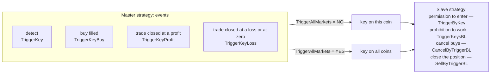

# 04. Strategy links: Master → Slave triggers, sessions and joining take-profits

> **Official Moonbot documentation:** [“Triggers Master/Slave” Tab](https://moonbot.pro/documentation/general-parameters-for-all-strategies/triggers-masterslave-tab) | [“Session” Tab](https://moonbot.pro/documentation/general-parameters-for-all-strategies/session-tab) | [Manage Triggers](https://moonbot.pro/documentation/menu-button/manage-triggers) | [Moon News](https://moonbot.pro/documentation/menu-button/moon-news) | [Order merging: “Multiple Orders” Tab](https://moonbot.pro/documentation/general-parameters-for-all-strategies/multiple-orders-tab)  
> **Related sections:** [01. Coin selection and the filter system](01-market-selection-and-filters.md) | [02. Market activity detects](02-detect-pipeline-and-signals.md) | [03. Spike hunting: MoonShot, MoonHook and MoonStrike](03-spike-hunting-mechanics.md) | [06. Orders, take-profits and stops](06-orders-exits-and-stops-cascade.md) | [Reference: triggers and sessions](../reference/params/07-triggers-and-sessions.md) | [Archetype 04. Master → Slave links](../examples/strategies/04-master-slave-scout-and-ladders.md) | [Archetype 05. BTC dump shield](../examples/strategies/05-btc-dump-shield-and-delist-guard.md)

---

## 1. Why link strategies

One strategy sees the market from one angle. A volume detector notices a large player in the feed but cannot track an order for a spike; `MoonShot` catches the spike very well, but on hundreds of coins it runs into the exchange's and the terminal's order limits and freezes capital in sleeping pairs; no strategy on its own will learn that Bitcoin is breaking into a crash or that a delisting news item has come out on the coin. A strategy link solves three tasks that one strategy cannot:

- **separate scouting and entry** — a cheap broad detector finds the coin, and the expensive precise entry switches on only where and when the detector gave a signal;
- **collective protection** — one guard strategy on `BTC` or on news lifts the buys and closes the positions of all live strategies with one key;
- **a position built from several strategies** — adding to the position, a take-profit ladder, closing the slave together with the master.

The means of communication is the **trigger key**: a number from `1` to `200` that the master strategy (`Master`) lights on a coin at the moment of an event, and the slaves (`Slave`) read as permission to enter or a prohibition to work. A key is not a “buy” command but a timestamp on the coin: the slave still passes its own filters and detect; it just gets the right to do so only while the key is alive.

> [!IMPORTANT]
> Passing and checking keys, and with them strategy sessions, work only with the **Autotrading** module activated or with the terminal's global emulation mode enabled (**Menu → Emulation mode**). The `EmulatorMode = YES` checkbox on an individual strategy is not enough. Without the module there will be no errors — the conditions are silently skipped: the slave enters without the master on any coin that passed its filters, the `BTC` shield blocks nothing.

---

## 2. The trigger key: when it is lit and how long it lives

### Four events of the master strategy

| Master parameter | When the key is lit | What matters to know |
| :--- | :--- | :--- |
| **`TriggerKey`** | At the moment of the detect — even with `AutoBuy = NO`, that is, for a purely signal strategy | The main key of scouts on detects (`Pump`, `Drops`, `Volumes`, `Activity`, `Spread`, `EMA`, `Telegram`, `Watcher`). **`MoonShot` does not have this field** — it places an order without a detect and passes a key only by a buy. `MoonStrike` gives a detect key only when it is itself ready to enter (`AutoBuy = YES`, `OrderSize > 0`); emulation mode turns it into a sensor with no money at stake. The manual `Manual` strategy lights this key when a buy is placed, and only with `ActiveTrigger = YES`. |
| **`TriggerKeyBuy`** | On every fill of a master buy | The working key of `MoonShot` scouts, add-ons and ladders: it means “the price really reached the order”. |
| **`TriggerKeyProfit`** | On a trade closing with a result strictly greater than zero | Starting the next cycle or a more aggressive strategy on a coin that has just given a profit. |
| **`TriggerKeyLoss`** | On any other close — at a loss **and at zero** | Coin quarantine after a loss or a safety pickup deeper. The same number in `TriggerKeyProfit` and `TriggerKeyLoss` gives a “trade closed” key regardless of the result. |

A scout with spot `AutoSell = NO` does not close the trade — its profit and loss keys are never lit; a cascade from such a scout is built only on `TriggerKeyBuy`.

**Where the key is placed.** `TriggerAllMarkets = NO` — only on the coin of the event; `YES` — on all coins of the terminal at once. The checkbox applies to all four events of the strategy, so “allow on this coin, forbid on the rest” cannot be done with one profile — two copies of the master are needed.

### How long a key lives

The lifetime is set by the **slave**, not the master: the general `TriggerSeconds` (default `60`) for permitting keys, `TriggerSecondsBL` for blocking ones, or individually right in the list — `TriggerByKey = 10=180 15=60 3=16k` (the `k` and `m` suffixes are thousands and millions of seconds, integers only). The countdown runs from the last lighting: a repeat firing of the master extends the key. The general fields are capped at `864,000` seconds (ten days); an individual entry accepts any positive number, and on zero or a typo falls back to the general field.

> [!WARNING]
> **Zero means “never”, not “unlimited”.** `TriggerSecondsBL` is `0` by default, so a blocking key without its own time does not act for a single second: it does not block entry, does not cancel buys via `CancelByTriggerBL` and does not sell via `SellByTriggerBL`, even if it is written into all three fields. Give every key in `TriggerKeysBL` a time right in the list (`102=120`) or a non-zero `TriggerSecondsBL`. The same with permitting keys: a key without a time with `TriggerSeconds = 0` will not start the slave.

Keys are stored together with the market data and survive a terminal restart if it was down for less than an hour; after a longer pause all keys on all coins are reset. For long blocks like `109=86400` this is significant.

### Holding the key while a buy waits: `ActiveTrigger`

With `ActiveTrigger = YES` the master continuously refreshes its key the whole time its buy order waits to fill — a limit order in the order book or a `BuyLimit` / `BuyStop` conditional level that is not yet on the exchange; after the fill or cancel, the slaves work for another `TriggerSeconds`. For scouts this is convenient: the slave is admitted the whole time the master is “on the hunt”. Two traps:

- For `MoonShot` it is `TriggerKeyBuy` that is held — **before the buy**, while the limit order simply sits in the order book. A `MoonShot` scout that must pass the key strictly at the moment of the spike is given `ActiveTrigger = NO`.
- Together with key clearing (`ClearTriggerKeys`, `ClearTriggersBelow / Above`), holding turns into a “lawn mower”: every refresh of the key erases others' keys on the coin again, as long as the order stands.

### The system keys `201` and `202` from Moon News

The news module lights two reserved keys on **any** accepted news item, regardless of tags: `201` on the coins mentioned in the news, `202` on all coins of the terminal. Putting `202` into `TriggerKeysBL` or `SellByTriggerBL` as a “delisting key” is not allowed — an ordinary announcement would stop or close all positions. To react specifically to a delisting, a strategy with `SignalType = Telegram`, `ChannelName = MoonNews` and `ChannelKey = Delisting` is created, which lights its own key (for example, `109`). The tag arrives with a refined copy of the news item, and news older than about ten seconds by event time gives no signal — this is a safety net, not a guarantee; the main protection against delisting is the selection filters and stops ([chapter 01](01-market-selection-and-filters.md)).

Which numbers are already taken and by which strategies, and which are free, is shown by **Menu → Manage Triggers** (`Used Keys`, `Free Keys`). There a key can also be lit or cleared manually on selected coins (`Set` / `Clear`) — this is the main way to test a link without waiting for a signal. Which keys are currently lit on a coin the window does not show — that is visible in the slave's “Filters on charts” (`This market is not triggered…` / `…BlackListed … by trigger…`).

---

## 3. The slave strategy: permission, prohibition, emergency exit

**Permission to enter — `TriggerByKey`.** A space-separated list of keys works as “OR”: one live key is enough. `TriggerByAllKeys = YES` switches it to “AND”: all the listed keys are needed at the same time; the lighting order does not matter. When the order of detects and the pause between them is what matters, the `SignalType = Combo` strategy serves: `ComboStart` and `ComboEnd` take **strategy names**, not key numbers, and `Combo` gives its own key if the second one fired on the same coin `ComboDelayMin .. ComboDelayMax` seconds after the first.

**Prohibition to work — `TriggerKeysBL`.** While any key from the list is alive on the coin, the slave does not enter. `CancelByTriggerBL = YES` additionally cancels buys and conditional orders already standing; `MoonShot` and strategies with `CheckAfterBuy = YES` cancel them on a blocking key even without this checkbox — the others need it.

**Close the position — `SellByTriggerBL`.** Keys from this list close an open position. Two mandatory conditions: the key must also be in `TriggerKeysBL` with a non-zero time (`TriggerKeysBL = 102=120`, `SellByTriggerBL = 102`), and the field itself accepts **numbers separated by spaces only** — the entry `102=120` here counts as an error. The exit goes the same way as a sell on leaving the filters: with `SellByFiltersDelay` set, the take-profit is first moved to the market once, and `Panic Sell` kicks in when the delay expires; `Panic Sell` itself obeys this strategy's stop — `StopLossSpread`, `AllowedDrop`, `UseMarketOrder` ([chapter 06](06-orders-exits-and-stops-cascade.md)). For trades with a joined take-profit, the strategy managing the combined exit supplies the settings. When protecting against a delisting with a gap, check exactly these parameters on the slave.

> [!CAUTION]
> **A typo in a key number stops the strategy entirely.** A non-numeric element in `TriggerByKey`, `TriggerKeysBL` or `SellByTriggerBL` (including `102=120` in the last one) forbids the slave any new entries, rather than just breaking one key; an error in `SellByTriggerBL` also disables emergency closing by keys. In the log these are the lines `Wrong TriggerByKey`, `Wrong TriggerKeysBL`, `Wrong SellByTriggerBL`. An error in the time (`1=abc`) does not block — the key lives the general time; an error in `ClearTriggerKeys` is only written to the log.

**Debugging.** The reason for a slave's silence is shown by “Filters on charts”: `This market is not triggered (By key 10 ...)` — the key is not lit or has expired, `This market is BlackListed ... by trigger 102` — a blocking key is holding it. A key can be lit by hand via Manage Triggers → `Set`.

**What a trigger cannot do.** A blocking key immediately forbids new entries and sends a cancel for standing buys, but it will not undo a buy the exchange has already filled. If several coins started in the same second, the trigger will not separate them — the number of simultaneous entries is limited by the strategy's order limits (`MaxActiveOrders`, `MaxMarkets`, `MaxOrdersPerMarket`), not by keys.

---

## 4. Key clearing and cascades

The clearing fields — `ClearTriggerKeys` (a list of numbers), `ClearTriggersBelow` and `ClearTriggersAbove` (`YES / NO` checkboxes) — clear keys at the moment the strategy lights its own. Four rules without which cascades do not work:

1. **Clearing fires only together with the strategy's own non-zero event key.** If keys need to be cleared on a buy, the strategy must have its own `TriggerKeyBuy > 0` — at least a technical number nobody listens to. With `TriggerKeyBuy = 0` clearing is not invoked.
2. **A local strategy can clear itself; a global one cannot.** With `TriggerAllMarkets = NO` the key is first written, then the list is cleared, so `TriggerKey = 20` together with `ClearTriggerKeys = 20` gives exactly one firing and a clean market. With `TriggerAllMarkets = YES` the strategy's own key is broadcast to all coins after the clearing — self-clearing is impossible.
3. **“Below” and “above” are counted from the number being lit.** `ClearTriggersBelow = YES` on key `50` clears `1..49`, `ClearTriggersAbove = YES` — everything higher, including the news keys `201` and `202`. So the intermediate steps of a cascade are given lower numbers, and the final closing event a higher key with `ClearTriggersBelow`, which resets the chain for a new cycle in one stroke.
4. **Clearing is not tied to one event and respects `TriggerAllMarkets`.** The checkboxes act on all events of the strategy (on a buy, `1..19` go out; on a profit, `1..49`), and with the global checkbox — on all coins: a `BTC` shield with `ClearTriggersBelow` will erase the lower keys across the whole market.

> [!WARNING]
> **The shared key of a ladder is not cleared in its steps.** Slaves are checked in turn in one pass: if the first step of a take-profit ladder erases key `30`, the second will no longer see it, and the ladder will not fill out. Each step fires once thanks to a short key window (`TriggerByKey = 30=2`) and a repeat-detect pause longer than the window (`NextDetectPenalty = 30`) — this is how [template 04C](../examples/strategies/04-master-slave-scout-and-ladders.md) is assembled.

---

## 5. Three working links

### A scout in the emulator → a sniper in real trading

**Task.** Catch `MoonShot` spikes on two hundred coins without holding two hundred orders on the exchange. **Solution** ([template 04A](../examples/strategies/04-master-slave-scout-and-ladders.md)): a master `MoonShot` in the emulator at a close distance (`MShotPriceMin = 0.9`, `MShotPrice = 1.3`) with `TriggerKeyBuy = 10` and `ActiveTrigger = NO`; a slave real `MoonShot` deeper (`1.8 .. 2.5%`) with `TriggerByKey = 10=180`. While the market sleeps, there is not a single order of yours on the exchange. When the first spike fills the scout's virtual order, the sniper, at the next selection cycle, takes its depth from the already shifted price and waits for a continuation or the next spike while the key is alive. It does not catch the same spike that hit the scout: the scout says “spikes have started on this coin”, nothing more.

Three conditions without which the link does not work:

- **The terminal's order limit.** The scout's virtual orders take up places in the shared limit of simultaneous `MoonShot` orders on a par with real ones. Without the **“Unlimited orders”** checkbox (Settings → Advanced → System), the Max Orders field cannot be raised above `30`: a scout on two hundred coins will take all the places, and neither the sniper nor the protective strategies will have anywhere to stand. Enable the checkbox and set Max Orders with headroom for the scout, the sniper and the protection.
- **Spot: `AutoSell = NO`.** A buy without a sell completes the scout's task at once — the coin is free for the next firing, there is no take-profit, no close, no traces in sessions and pauses. Otherwise a virtual trade, closing at a loss, will turn on `TradePenaltyTime` and `PenaltyTime` on the coin for all strategies where they are set, and will light `TriggerKeyLoss`.
- **Futures.** There `AutoSell` is hidden and forced to `YES`: the scout holds a virtual position until it closes and all that time does not re-arm on this coin. Give it closing conditions (`SellPrice`, `StopLoss`) and disabled session thresholds. `MShotRepeatAfterBuy` is not an exit but a repeat shot with the position still open, in the `MShotRepeatDelay .. MShotRepeatWait` window, by the `MShotRepeatIfProfit` / `MShotRepeatIfDrop` conditions.

### A tiered shield against a Bitcoin sell-off

**Task.** On a `BTC` break, remove the close long limit orders, and on a crash close the positions. **Solution** ([template 05](../examples/strategies/05-btc-dump-shield-and-delist-guard.md)): two guard strategies on `BTC` (`CoinsWhiteList = BTC`, `EmulatorMode = YES`, `TriggerAllMarkets = YES`) light the global keys `101` and `102`; all live longs have `TriggerKeysBL = 101=45 102=120`, `CancelByTriggerBL = YES`, `SellByTriggerBL = 102`. Key `101` cancels buys across the whole market and keeps the strategies out of the market for 45 seconds, while open positions finish by their own take-profits and stops; key `102` starts emergency closing by each strategy's stop rules.

A `MoonShot` shield catches a **sudden price drop**: its virtual order stands at the set distance from the price and is pulled along after a smooth decline, so a slow stepwise slide can cover two percent and never fill the order. The two tiers are “a moderate sudden drop” and “a larger sudden drop”, not “minus so much from the start of the fall”. Against a drawn-out sell-off, protection comes from a master that measures the fall itself — by the `BTC` delta or a `CustomEMA` formula on `BTC` ([chapter 05](05-ema-geometry-and-formulas.md)) — with the same global key. On futures a `MoonShot` shield, once fired, holds a virtual position and does not re-arm while it is open — it, too, needs a short exit.

### Adding to the position, a take-profit ladder, closing the slave with the master

**A static add-on** ([template 04B](../examples/strategies/04-master-slave-scout-and-ladders.md)). A slave `EMA` with an “always true” formula, on the master's buy key (`TriggerByKey = 20=3`), places a `BuyLimit` conditional order with `buyPrice = -2.0`; the parameter name is exactly `buyPrice`, with a lowercase letter, otherwise it is not recognized on text import. The distance is counted from the price at the moment the **slave** fires, not from the master's buy price: the key arrives right after the buy, so this is usually close, but not guaranteed. The master must have `TriggerKeyBuy = 20`, `JoinSellKey = 20`, `OneOrderPerMarket = NO` and **`CancelBuyAfterSell = YES`** — otherwise an add-on order that never got its price will outlive the closing of the main position and later open an independent trade on a falling coin. After the level is touched, the conditional order lives about three seconds: this is an attempt to buy at the moment of the touch, not a limit order lying in the book; for a real limit order take `BuyType = Buy` with a negative `buyPrice`.

**A take-profit ladder** ([template 04C](../examples/strategies/04-master-slave-scout-and-ladders.md), [“Triggers Master/Slave” Tab](https://moonbot.pro/documentation/general-parameters-for-all-strategies/triggers-masterslave-tab)). The master buys the first part and lights `TriggerKeyBuy = 30`; slave `EMA`s (`OneOrderPerMarket = NO`, no `JoinSellKey`) buy their parts and place independent take-profits at `+0.8`, `+1.6`, `+2.8%`, each with its own stop and trailing. The key clearing rule is in section 4.

**Choosing depth via `BuyDelay`.** The order placement delay (`0 .. 3000` ms) by itself does not “assess” the spike in any way. The meaning appears in a pair with blocking keys: if during the delay a deeper step managed to light a key that the shallow one has in `TriggerKeysBL`, the shallow one is canceled — the cascade itself chooses the depth by the strength of the spike. It works only with `DontCheckBeforeBuy = NO`: it is the re-check before placement that sees the blocking key.

**Close the slave together with the master** ([“Triggers Master/Slave” Tab](https://moonbot.pro/documentation/general-parameters-for-all-strategies/triggers-masterslave-tab)). The master has identical `TriggerKeyProfit = 40` and `TriggerKeyLoss = 40`; the slave has `TriggerKeysBL = 40=2` (or `TriggerSecondsBL = 2`) and `SellByTriggerBL = 40`. This is how a bellwether coin closes positions on the coins that follow it.

---

## 6. Sessions: a series of trades as a unit of risk

A coin that gave clean bounces for half an hour can go into a series of stops. A session answers the question “how much has this coin already brought in or taken away” and changes the strategy's behavior by the accumulated result, not by one trade. The terminal has two independent circuits that are often confused.

| | Coin session | Strategy session |
| :--- | :--- | :--- |
| **Where** | The `Filters → Price/Position` tab: `SessionProfitMin` / `SessionProfitMax` (in `$`); disabled together with the `Price` group and `IgnoreFilters` | The `Session` tab; enabled with `IgnoreSession = NO` (sessions are off by default) and does not depend on `IgnoreFilters` |
| **What it counts** | The total of all closed trades on the coin since the last reset — by any strategy, manual and **virtual**, plus funding and liquidations | The total of **this strategy's** trades on this coin, in `USDT` |
| **How it resets** | `Menu → Reset Session`; “Auto reset session per N hours” without trades and the “Session Cap” upper limit — in Settings → Autostart | By its own thresholds and the `SessionResetTime` decay |
| **Emulator** | Virtual trades count like real ones: a scout with `AutoSell = YES` moves the `SessionProfitMin / Max` of the coin's live strategies. The “Ignore Emulator Trades” checkbox (Autostart) does not affect the session — it excludes the emulator only from the loss calculation for autostop | A virtual trade closing changes the strategy session the same way as a real one |

### How the strategy session works

The strategy keeps an accumulated result per coin and two counters — consecutive profitable sessions (`cPlus` on the chart) and losing ones (`cMinus`). Every closed trade is added to the result; the thresholds are set in `USDT` (`SessionLevelsUSDT = YES`) or in percent of `OrderSize` (`NO`; with `OrderSize = 0` the base is ten dollars, so with percentages set an explicit `OrderSize`).

- A result **below** `SessionStratMin` (a negative number) is a **losing session**: `cMinus` grows by one, `cPlus` is reset, the result is reset, the coin goes on a `SessionPenaltyTime`-second pause. Orders opened before the pause can still close at a loss and extend it. There is no “never trade the coin again” mode here: for that, use the black list or a blocking key with a long time.
- A result **above** `SessionStratMax` is a **profitable session**: `cPlus` grows, `cMinus` is reset, the result is reset, the strategy keeps working.
- The comparisons are strict, and **zero thresholds do not disable the mechanics**: with `SessionStratMin = 0` any losing trade closes a losing session, with `SessionStratMax = 0` any profitable one closes a profitable session. Enable the pause or the order reduction without thresholds, and you get a pause after every penny loss.
- `SessionResetOnMinus = YES` does not let the accumulated plus survive a large stop: if a trade's loss is greater than a tenth of `|SessionStratMin|`, the positive result of the current session is zeroed. The counters and the order size do not change.
- `SessionResetTime` is decay: once every set number of seconds, the result on all the strategy's coins decreases by ten percent, and non-zero `cPlus` and `cMinus` by one. Works only with `IgnoreSession = NO`.

The current `sMin` / `sMax` thresholds and the counters are visible on the chart: “Filters on charts” → `Show Sessions`, clear `Hide zero session`; only strategies with `IgnoreSession = NO` are shown. For a joined exit, the result is recorded to every participating strategy in full.

### Order size and thresholds by streak

The progression switches on from step `SessionPlusCount` (profitable) or `SessionMinusCount` (losing); zero disables it rather than starting it from the first session. On step $n = \text{counter} - \text{Count} + 1 \ge 1$:

- **a winning streak** — the order is multiplied by $(1 + \text{SessionIncreaseOrder}/100)^n$, but by no more than $1 + \text{SessionIncreaseOrderMax}/100$; the `SessionStratMax` threshold grows linearly by `SessionStratIncreaseMax` percent per step;
- **a losing streak** — the order is **divided** by $(1 + \text{SessionReduceOrder}/100)^n$, but by no more than $1 + \text{SessionReduceOrderMin}/100$; the allowed loss `SessionStratMin` shrinks by division by $1 + n \cdot \text{SessionStratReduceMin}/100$ — after a series of losses the session closes sooner.

Both order percentages are **positive** numbers. A negative `SessionReduceOrder` is zeroed on save, and there is no reduction; a negative `SessionReduceOrderMin` is zeroed too, the division limit becomes one, and the order does not shrink even with a correct `SessionReduceOrder`. The default `500` for both limits means a multiplier of $1 + 500/100 = 6$: growth by no more than six times, shrinkage to no less than a sixth (the terminal tooltip and the site say “5 times” — go by the formula). With `SessionReduceOrder = 20`, a `$1000` order becomes `$833` on the first step and `$694` on the second; with `50` — `$667` and `$444`; with `100` — `$500`, `$250`, and from the third step it hits the `$166.7` limit. The actual changes are written to the log: `OrderSize increased by ...` / `OrderSize reduced by ...`.

Masters with `TriggerKeyProfit` / `TriggerKeyLoss` and sessions complement each other: a key changes the behavior of *other* strategies after one trade, a session the behavior of the strategy *itself* after a series.

---

## 7. Joining take-profits: `JoinSellKey`

When several buys fill on one coin — a grid, a master with add-ons, several strategies on one signal — managing separate take-profits may be inconvenient. The same `JoinSellKey` joins the exit management of real trades on one coin in one direction: their remaining quantities are combined and managed with one take-profit based on the average entry price. The rules:

- **The managing strategy.** The joined take-profit is managed by the first started strategy **in the list** with this key, and if none is started — by the first one ticked. From it come the take-profit, auto-lowering, the stop, the trigger exit and the name in the report. If an add-on without a stop stands higher in the list, the combined exit will have no stop — put the strategy whose exit settings should apply higher in the list.
- **Where it does not work.** In the emulator, orders are not merged; `OneOrderPerMarket = YES` on any of the strategies disables merging; `Spread` has no merging.
- **The take-profit price — `JoinPriceFixed`.** `YES`: the managing strategy's calculated `SellPrice` percent is measured from the new average entry price — a take-profit that auto-lowering had managed to bring down to `+0.8%` will, after the add-on, stand at the full `+2.0%` again (for `MoonHook` and `MoonStrike` with their dynamic take-profit, fixing is not applied). `NO` (default): a simple average of the current percentages of the merged take-profits is taken, unweighted by size — at `+0.8%` and `+2.0%` the common take-profit will stand at about `+1.4%`, not at the first order's percent and not at the total money target, and not below the current price.
- **Tails and repeats.** An unfilled add-on order after the position closes is removed only by `CancelBuyAfterSell = YES` on the master (it acts on orders with the same non-zero `JoinSellKey`). After joining the common exit, the slave again has zero orders of its own, and while the key is alive it can enter once more — the brakes are the same as in the ladder: `NextDetectPenalty`, a short key window, clearing it.
