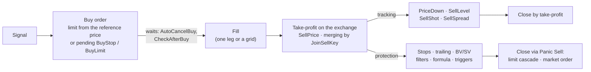

# 06. Orders, take-profit and stops: how the terminal manages a trade

> **Official Moonbot documentation:** ["Buy conditions" Tab](https://moonbot.pro/documentation/general-parameters-for-all-strategies/buy-conditions-tab) | ["Multiple Orders" Tab](https://moonbot.pro/documentation/general-parameters-for-all-strategies/multiple-orders-tab) | ["Sell order" Tab Parameters](https://moonbot.pro/documentation/sell-order-tab/sell-order-tab-parameters) · [SellShot](https://moonbot.pro/documentation/sell-order-tab/sell-order-sellshot-tab) · [SellSpread](https://moonbot.pro/documentation/sell-order-tab/sell-order-sellspread-tab) | ["Stops" Tab](https://moonbot.pro/documentation/general-parameters-for-all-strategies/stops-tab) | [Features of SHORT Strategy Settings](https://moonbot.pro/documentation/strategy-usage/features-of-short-strategy-settings) | ["Panic Sell" Block](https://moonbot.pro/documentation/settings-main-tab/panic-sell-block) | [Manual and automatic exit mechanisms: stop-loss, take-profit, and trailing stop](https://moonbot.pro/education/basics-of-risk-management/manual-and-automatic-exit-mechanisms)  
> **Related sections:** [01. Coin selection and filters](01-market-selection-and-filters.md) | [03. Spike hunting mechanics](03-spike-hunting-mechanics.md) | [04. Triggers and strategy links](04-triggers-and-master-slave.md) | [05. CustomEMA formulas](05-ema-geometry-and-formulas.md) | [Reference: buying and modifiers](../reference/params/03-buy-and-modifiers.md) · [grids and merging](../reference/params/04-multiorders-and-scales.md) · [selling](../reference/params/05-sell-and-take-profit.md) · [stops](../reference/params/06-stops-and-trailing.md) | [Archetype 02. Tiered MoonShot pack](../examples/strategies/02-moonshot-tiered-pack.md) | [Archetype 04. Adding with pending orders and take-profit ladders](../examples/strategies/04-master-slave-scout-and-ladders.md)

---

## 1. What happens after a signal

The detect ([chapter 02](02-detect-pipeline-and-signals.md)) answers the question "whether to enter". Everything else — at what price to enter, how long to wait for a fill, where to place the take-profit, how to move it, when to admit the mistake and exactly how to close the position — is done by the trade management mechanics. It is the same for all strategy types and is laid out across the settings tabs: **Buy conditions** (the buy order), **Multiple Orders** (grid and merging), **Sell order** with the **SellShot** and **SellSpread** sub-tabs (take-profit and its tracking), **Stops** (stops and trailing), **Delta Modifiers** (price adjustment for volatility).

**Entry and take-profit orders are placed on the exchange; a grid can have several entry orders.** Stops, trailing, pending levels, the exit by filters and by formula are rules inside the terminal. While it is running, they fire and turn into real orders; a switched-off terminal cannot execute these rules. There is one exception — the exchange-side stop of manual trading (section 6).

In Moonbot, `Buy` and `Sell` name the entry and exit stages. For a short, the entry is an exchange sell and the exit is an exchange buy; examples below describe a long unless stated otherwise.

Access conditions: in the Free version the number of active orders is limited (up to `30`); the exit by the `SellByCustomEMA` formula and triggers require the Autotrading module ([README](../README.md)).

---

## 2. Entry: the buy order and pending orders

### A limit order from the reference price

The terminal does not send market orders without a price. The `Buy` order is always a limit order, at `buyPrice` percent from the reference price at the moment of the signal. A negative `buyPrice` places the order below the market: it waits in the order book as a maker. A positive one throws it above the best ask: such an order usually fills at once, but the limit does not let you pay more than specified — this is protection against slippage on an empty order book. The reference is the current best ask; `buyPriceLastTrade = YES` takes the last trade price, `Use30SecOldASK = YES` the lowest ask over the last 30 seconds, `UseOldPrice = N` the price `N` seconds ago. The last two keep you from buying at the very top of the candle if the signal came late. `BuyDelay` (milliseconds, up to `3000`) holds a pause between the detect and sending — on vertical sell-offs this is a chance to place the order closer to the bottom rather than at the start of the fall. On top of `buyPrice` work the `BuyModifier` volatility modifiers ([reference](../reference/params/03-buy-and-modifiers.md)). The size is taken from `OrderSize`; when zero — from the general size on the main window.

### While the order waits in the order book

`AutoCancelBuy` cancels an unfilled order after the specified number of seconds (zero — do not cancel; for `MoonShot` not less than 15 seconds; moving the order restarts the countdown, except for the shot strategies). By default this is 300 seconds, and the same applies to pending orders — see below. `CheckAfterBuy` keeps checking the filters the whole time of waiting and cancels the order if the coin has left the corridor ([chapter 01](01-market-selection-and-filters.md), section 6). `CancelBuyAfterSell = YES` removes the strategy's remaining orders on the coin as soon as its take-profit has filled — so that after a bounce you do not buy back what you have just sold. The limits on simultaneous trades (`MaxActiveOrders`, `MaxOrdersPerMarket`, `MaxMarkets`, `OneOrderPerMarket`) are in the [reference](../reference/params/03-buy-and-modifiers.md).

### Pending orders `BuyStop` and `BuyLimit`

A pending order (`BuyType = BuyStop` / `BuyLimit`) lives only in the terminal until it triggers: it is not on the exchange, it does not freeze the balance and is not visible to other participants. On the chart these are two lines: the solid one is the level whose crossing the terminal waits for, the dashed one is the price at which the real limit order will be placed after the crossing (the offset from the level is set by `PendingOrderSpread`, with sign). `BuyStop` stands above the price — entry on a breakout; `BuyLimit` below — entry on a sell-off to the specified depth.

A crossing is not counted by a single tick: the level must be passed both by the order book quote and by the average trade line — a single-tick spike does not trigger the pending order. But there is no confirmation of a reversal either: `BuyLimit` buys as soon as the price has passed the level downward, including in the middle of a continuing fall; a bounce, if needed, is checked by a separate condition — a filter or a formula. After triggering, the real order lives **3 seconds** and is cancelled if it has not filled: a pending order catches a moment rather than standing in the queue. While the pending order waits, the strategy keeps checking the filters for it and cancels it if the coin has left the corridor; `AutoCancelBuy` counts from the moment the pending order was placed, not from the moment it triggered — if the level has to wait for the price for hours, set `AutoCancelBuy = 0` in such a strategy.

---

## 3. Order grids and joining take-profits

Guessing the depth of a sell-off with one order is hard: a close one fills at the start of the candle, a far one does not reach a short spike. A grid (the **Multiple Orders** tab, `OrdersCount > 1`) spreads the entry over several levels and averages the price as the move goes on. `MoonShot` and `UDP` have no grid, nor is there one with `OneOrderPerMarket = YES`.

### Price step and size step

The price step `BuyPriceStep` is set in percent of the first price. A negative step lays the legs out **against the position** — below the first order in a long, above it in a short: the sign is not changed for a short, the terminal mirrors the direction itself. A positive step places the legs along the position; in a short these are sell orders below the market, which on a falling market fill at once — the grid collapses into a single point. The step law is chosen by `BuyStepKind` (the formulas are for a long; in a short the levels are mirrored by division, section 7): `Linear` — leg `k` is offset by $(k-1)\cdot\text{BuyPriceStep}$; `Exponential` — the offset grows faster, the far legs spread apart:

$$P_k^{\text{Linear}} = P_1\Bigl(1 + \tfrac{(k-1)\,\text{BuyPriceStep}}{100}\Bigr), \qquad P_k^{\text{Exp}} = P_1\Bigl(1 + \tfrac{(k-1)\,\text{BuyPriceStep}}{100}\Bigr)^{k}$$

With the default step of `-1.5` and five legs, the linear grid stands at `-1.5 / -3 / -4.5 / -6%`, the exponential one at approximately `-3 / -8.7 / -16.8 / -26.6%`. On saving, a negative step is capped so that the last leg does not go to a zero price.

The size of the legs is set by `OrderSizeStep` under the `OrderSizeKind` law. In `Linear` each next leg is larger than the first by `OrderSizeStep %` of the first; equal sizes — `0`. In `Exponential` each next leg is **multiplied** by `OrderSizeStep / 100`: `200` — doubling (martingale), `150` — one and a half times, equal sizes — **`100`**.

> [!WARNING]
> In `Exponential` mode the habitual zero breaks the grid: a multiplier of `0` zeroes all legs from the second on, and only the first goes to the exchange. A value below `100` (for example `50`) makes the legs decreasing — each next one half the size. Equal legs in `Exponential` are `OrderSizeStep = 100`.

Grid timers: `CancelBuyStep` adds seconds to `AutoCancelBuy` for each next leg, so that the grid is cancelled in steps rather than all at once; with `AutoCancelBuy = 0` there is no stepped cancellation at all — zero here means "do not cancel", not "cancel immediately". `IgnoreCancelBuy = YES` removes the timer from the rest of the grid as soon as the first leg has filled: the deep averaging legs wait until the position is closed.

### Merging into one take-profit: `JoinSellKey`

Filled grid legs, repeat entries and trades of several strategies on one coin can share one take-profit and exit management. The `JoinSellKey` key (zero — off) joins real trades of one coin and direction with the same key; the parameters of the common take-profit and stops are taken from the managing strategy — the topmost running one with this key, or, if none is running, the first ticked one. The direction is not taken into account when choosing the managing strategy, so long and short strategies are given **different** keys — otherwise a long position will get the settings of a short strategy. The price of the common take-profit with `JoinPriceFixed = NO` is the average current percentage of the merged take-profits from the new average entry price (the money target is not preserved); with `YES` it is the managing strategy's `SellPrice` (for `MoonHook` and `MoonStrike` — the common path). Details are in the [reference](../reference/params/04-multiorders-and-scales.md).

A merged take-profit is a **new order**: the `PriceDown`, `SellLevel`, `StopLossDelay` timers and the stop switching timers, the trailing peak are counted anew; an already triggered second stop is lost. Hence the frequent bewilderment "after adding to the position the take-profit stands high again and the lowering has started from zero". `StopLossFixed = YES` leaves the stop of the first leg in place on merging, without moving it after the averaging.

### Splitting a position

A large position is more convenient to close in parts. `SplitPiece` (a share up to `50%`), on the `Split Piece` command from the order's context menu, the `SellPiece` command of the orders panel or the `SellPiece` Telegram command, separates a piece and places it below the main take-profit. `Split Order` in the order menu spreads the take-profit into a fan of several limit orders. `Market Split` in the position menu (real trading only) closes the position in five market parts with random weights; on Hyperliquid, where there is no market order, part goes as immediate-execution orders, part as limit orders at the oracle price.

---

## 4. Take-profit and the four algorithms for tracking it

### Where the take-profit price comes from

After the buy fills, the terminal places the take-profit from the actual average entry price. Sources by precedence: the order's fixed price → the own price of the shot, hook and strike strategies ([chapter 03](03-spike-hunting-mechanics.md)) → the price from an external signal → the strategy's `SellPrice` (by default `0.5%`) → the terminal's general take-profit when `SellPrice = 0`. Then `SellModifier` raises the take-profit on a volatile market, and `UseScalpingMode = YES` with `SellPrice` not above `1%` can tuck it under a large sell wall up to `2%` — a built-in analog of the general "Fit sell order in best place in the order book" checkbox. `SellDelay` (milliseconds) postpones placing the take-profit so as not to show the volume in the first instants of the impulse.

### Who is in charge when there are several algorithms

On each tracking pass the order is the same: if Panic Sell is on, everything else is cancelled; then the exit by filters, `SellShot`, `SellSpread`, `SellLevel` — only the first applicable algorithm moves the take-profit on that pass; then the manual move; `PriceDown` last. **Any move of the take-profit through the common path — by hand on the chart, by the `SellShot` and `SellSpread` algorithms, by the first step of `SellByFiltersDelay` — permanently stops `PriceDown` for this trade.** `SellLevel` is the exception: it does not stop `PriceDown`, both keep moving the same order, each on its own timer, and can move it in opposite directions — when enabling both, separate them in time. A manual move, in turn, does not switch off `SellLevel`, `SellShot` and `SellSpread`: they will re-place the order over your level until their time or number of attempts runs out.

### `PriceDown` — the take-profit toward the price on a timer

If a fast bounce has not happened, `PriceDown` lowers the take-profit toward the market to close the trade with a small plus before the stop. The first step is `PriceDownTimer` seconds after the take-profit is placed, then every `PriceDownDelay` seconds by `PriceDownPercent` — an absolute percentage of the price or, with `PriceDownRelative = YES`, a share of the remaining distance to the entry price (the step slows down near the entry; `PriceDownToAllowedDrop` counts the share to `PriceDownAllowedDrop`, which allows going smoothly into the minus). The take-profit does not go below `PriceDownAllowedDrop` (by default `0.1%`); `PriceDown` cannot raise it. `PriceDownDelay` can be fractional and even zero — then the take-profit slides to the floor as fast as the terminal manages to re-place the order.

### `SellLevel` — the take-profit on a return to a recent high

When a rise runs into a wall and pulls back, the next approach often reverses a few ticks lower. `SellLevel` takes the price maximum over `SellLevelTime` seconds (by default an hour — including the time before the entry; this is a bet on a return to the recent high) and re-places the take-profit relative to it `SellLevelDelay` seconds after the buy, then every `SellLevelDelayNext`, no more than `SellLevelCount` times. With `SellLevelRelative = NO` the `SellLevelAdjust` correction is a percentage of the maximum: a negative one puts the take-profit below the wall, a positive one (by default `0.2`) above it. With `YES` it is a share of the path from the entry price to the maximum: `99` — almost at the maximum, `50` — the middle. `SellLevelAllowedDrop` is not a floor but a condition: if the calculated level is below it, the re-placement is postponed until a better maximum. `SellLevelWorkTime` limits the algorithm's working time and must be greater than `SellLevelDelay` — otherwise the first re-placement will not have time to happen.

### `SellShot` — the take-profit in a corridor above the market

The mirror of `MoonShot` for the closing order (`IgnoreSellShot = NO`): the take-profit is kept at `SellShotDistance` percent from the local maximum over `SellShotCalcInterval` seconds, inside a corridor of `±SellShotCorridor` percent of the distance in each direction. With a distance of `1%` and a corridor of `50` the take-profit wanders between `0.5%` and `1.5%` from the market; once it leaves, it returns to `1%`. The wider the corridor, the rarer the re-placements. The price rises — the take-profit goes higher after it; `SellShotPriceDown` after `SellShotDelay + SellShotPriceDownDelay` shrinks the distance, pressing the take-profit to the market. The `SellShotAllowedUp` / `SellShotAllowedDown` bounds limit the travel from the entry price, and by default the lower one (`-0.1`) lets the take-profit go slightly **below** the entry — check it. `SellShot` re-placements switch off `PriceDown`.

### `SellSpread` — the take-profit inside the "saw"

On coins where the price darts by whole percents within fractions of a second, `SellSpread` (`IgnoreSellSpread = NO`) catches such a swing over the last seconds and, if it is not less than `SellSpreadMinSpread`, places the take-profit inside it: below the top by `SellSpreadDistance` percent **of the width** of the swing (a width of `5%` and `-10` give a take-profit at `4.5%`), but not below `SellSpreadAllowedDrop`. `SellSpreadReplaceCount` limits the number of re-placements; zero — place it once under the swing when the position opens and do not touch it again.

---

## 5. Stops, trailing and other reasons to exit

### At what price the stop is checked

The stop (`UseStopLoss = YES`, the `StopLoss` level in percent of the entry, by default `-5`) fires when the best bid has touched the level **or** the average trade line has gone below it. Such a stop does not ignore a single-tick bid spike; `StopLossEMA` (`3`, `5`, `10`) helps filter out these spikes — a smoothed bid instead of the raw one, which matters for ambush strategies like `MoonShot` and `MoonHook`, where the bid can briefly dip below the entry price during a spike and then recover. The smoothing acts in the long check; in a short there is no such smoothing. `FastStopLoss = YES` adds a second check — by the trade price: if over several consecutive checks the last trade price stays beyond the stop level, the stop fires even if the bid has not reached the level. Checks are counted, not distinct trades: a single trade that remains the last one can also lead to a stop — the flag guarantees neither a reaction to the first print nor protection from a single-tick spike; on a breakout the exit is earlier, but a feed with isolated spikes triggers it more often; not recommended in `MoonShot`, does not affect trailing. `StopLossDelay` postpones the main stop, its moves and trailing by the specified seconds after the take-profit is placed (`BV/SV` and `V-Stop` do not fall under the delay) — for cases when a wall has been put under the price that will leave by itself; the stop switching timers are already running meanwhile. The `StopLossModifier` modifier moves the stop further away on a volatile market ([reference](../reference/params/03-buy-and-modifiers.md)).

### The `Stop 1 → 2 → 3` cascade and breakeven

The second (`UseSecondStop`) and third (`UseStopLoss3`) stops are a **move of the main one**, not independent stops: with `UseStopLoss = NO` they will not switch on. The move happens when **simultaneously** `TimeToSwitch2Stop` seconds have passed since the take-profit was placed **and** the price is on the favorable side of the `PriceToSwitch2Stop` threshold from the entry — above it in a long, below the mirrored level in a short; the level becomes `SecondStopLoss` (for the third — `TimeToSwitchStop3`, `PriceToSwitchStop3`, `StopLoss3`). The classic is breakeven (example for a long): `PriceToSwitch2Stop = 0.6`, `SecondStopLoss = 0.15` move the stop into the plus zone once the price has risen by `0.6%`. This is a move of the stop into the breakeven zone, not a guarantee of a plus: the closing order after triggering may land lower, and the level does not account for the fee.

> [!WARNING]
> **The "AND" trap.** Want to tighten the stop by time while the trade is in the minus? With `PriceToSwitch2Stop = 0` the second stop will not switch on while the trade is in the minus. Set a negative threshold deeper than the first stop — for example `-20`. A second stop that fires later than the third overwrites its level. Only the third stop has its own chase limit (`AllowedDrop3`); for the second the main `AllowedDrop` applies.

**A stop by time.** A positive `StopLoss` places the stop above the entry price — it fires at the very first check and closes the position via Panic Sell. With `StopLossDelay = 60` and `StopLoss = 50` this is "close in a minute, whatever happens"; the same trick — a positive `SecondStopLoss` by `TimeToSwitch2Stop`. The flip side: an accidental plus in `StopLoss` gives a Panic Sell right after the buy — the first thing to check when a strategy "buys and instantly sells".

### Trailing

Trailing is **enabled by default** (`UseTrailing = YES`, `TrailingPercent = -3`, `UseTakeProfit = YES`, `TakeProfit = 1`) — a strategy in which it has not been touched trades with it. The terminal tracks the price peak by the midpoint between the bid and the ask (`TrailingEMA` smooths the peak so that a single upward spike does not pull the line up into an empty order book) and keeps the line `TrailingPercent` below the peak; a pullback below the line starts Panic Sell. `TrailingSpread` is not the chase step but the spread of the closing order on triggering. The line appears after `StopLossDelay`, and until the price has gone into the plus, trailing with `UseTakeProfit` stays silent.

`UseTakeProfit = YES` turns trailing into protection of what has already been earned: it switches on only when both the price and the pullback line itself are above the `TakeProfit` level. Hence the geometry of the threshold: with an entry at `100`, `TakeProfit = 0.8` and `TrailingPercent = -0.65` the peak must reach $100.8 / 0.9935 \approx 101.46$ — not a simple sum of `1.45%`. The chase floor on triggering is the `TakeProfit` level minus `StopLossSpread`, not `TakeProfit` itself: with the defaults `1` and `1` this is roughly the entry price. If a pullback has broken both the line and `TakeProfit` in one move, trailing will no longer switch on — the position is then guarded by the ordinary stop. The main window's general slider "Add … to trailing per each % of price" changes trailing for strategy orders too. Narrow trailing on second-scale spikes with an instant return knocks the trade out on noise — its place is on smooth trending moves.

### A stop by the trade feed: `BV/SV Stop`

`UseBV_SV_Stop = YES` looks at the ratio of money taken by buyers to money taken by sellers over the last `BV_SV_TradesN` trades or seconds (`BV_SV_Kind`) — the other way around for a short. It works almost immediately after the take-profit is placed, without waiting for `StopLossDelay`, but only while the price is on the favorable side of `BV_SV_TakeProfit` from the entry: by default `-1`, that is, also in a small minus. A fall of the ratio below `BV_SV_Ratio` closes the trade at the start of a counter-flow; the order's spread is `TrailingSpread`. `BV_SV_Reverse = YES` swaps the numerator and the denominator, and then the stop locks in the climax of the move in your favor; the threshold is set as the reciprocal — "exit when buys have outweighed sells twofold" is `BV_SV_Ratio = 0.5`. With `BV_SV_TakeProfit < 0.1` the same threshold works as an entry filter: a coin where the stop would fire at once is not taken by the strategy.

### A stop by the order book: `V-Stop` in manual trading

When trading a bounce off a buy wall, waiting for a percentage stop can be too late: the price can fall sharply when that liquidity disappears. `V-Stop` is enabled on a specific order (the order window, `VStop`); the level is set by the slider **Settings → Main → "V-Stop: sell if BID volume at [buy] −XX% drops"** or a fixed price, the threshold is the volume of your side of the order book down to this level. The bid volume falls below the threshold — Panic Sell starts by the strategy's rules while there is still liquidity under the price; the price and completeness of the fill depend on the market. There is no `V-Stop` in automatic strategies; the closest analog is `BV/SV Stop`.

### Liquidation protection on futures

`StopAboveLiq` (percent, zero — off) works in any margin mode if the exchange reports the liquidation price: a stop that ends up beyond it is pulled to an offset of `StopAboveLiq` before the liquidation price (not right up to the entry); a closer stop is not touched. This is insurance for the stop, not its replacement, and it requires the main stop to be enabled; its second role is to keep `PriceDown` from crossing the same boundary. `DontSellBelowLiq = YES` acts only on isolated margin with leverage above one: the Panic Sell closing order is not placed worse than the calculated liquidation price (in the log `Stop level (...) is below than liq level`). `StopAboveLiq` changes the trigger level and acts with any exit method; `DontSellBelowLiq` limits the price of the limit order only — the `UseMarketOrder` market order fills by the order book and does not guarantee a price before liquidation.

### Exit by filters, formula, trigger and delisting

`SellByFilters = N` closes the position `N` seconds after the buy if the coin has stopped passing the filters ([chapter 01](01-market-selection-and-filters.md), section 6); `SellByCustomEMA` — when the formula has become true ([chapter 05](05-ema-geometry-and-formulas.md)); `SellByTriggerBL` — by another strategy's key ([chapter 04](04-triggers-and-master-slave.md)); `PanicSellDelisted = YES` — on a delisting message from the `@MoonInt` channel (consent to statistics sharing is required). All of them close the position with the same Panic Sell with the strategy's `AllowedDrop`, regardless of `UseStopLoss`. `SellByFiltersDelay` softens such an exit into two steps: first the take-profit is moved once to the current price (not below `PriceDownAllowedDrop`, with liquidation protection taken into account), and only if the position has not closed within the specified seconds — Panic Sell.

---

## 6. How a position is closed: three Panic Sell modes

Any stop, trailing, exit by filters, formula or button is a virtual event. At the moment it fires, the terminal starts Panic Sell: the closing order is taken off the take-profit and placed so as to fill. There are three ways.

| Mode | How it closes | Where | Exit price | What you pay with |
| :--- | :--- | :--- | :--- | :--- |
| **Limit cascade** (default) | a limit order `StopLossSpread` deeper than the market; when the price moves away — re-placement after it, more aggressive each time | all exchanges, all strategies | not below the `AllowedDrop` floor | the risk of not filling on a crash |
| **Market order** `UseMarketOrder = YES` | a market order; if the exchange refuses — fallback to the limit cascade | Binance, Bybit, Gate, Bitget; not for a short on spot | whatever is in the order book; no `AllowedDrop` and no liquidation protection | slippage |
| **Exchange-side stop** `UseMarketStop = YES` + the `SM` button | a conditional stop stands on the exchange and fires without the terminal | `Manual` manual trading (and remote control orders) on Binance | by the exchange's rules | on the exchange either a take-profit or a stop — not both |

**The limit cascade.** The order is placed below the lowest of the current prices — the best bid and the last trades — by `StopLossSpread` (`0.1..10%`; the site recommends `0.4..1.5`), so as to fill against the counter orders at once rather than stand in the queue while the market leaves. If the price has managed to drop, the order is re-placed after it, and the offset grows with each re-placement — to catch up with a running order book, but not without limit. On coins with a large minute range the offset is widened in advance: `StopSpreadAdd1mDelta` is a coefficient to the minute range (a range of `25%` and a coefficient of `0.1` add `2.5%`). Too small a spread on a sell-off means many re-placements and a worse final price — this is the first setting to check when "Panic Sell cannot sell in time".

**The chase floor.** `StopLoss` decides *when* to exit; `AllowedDrop` — *down to what price* the closing order is allowed to chase the market. This is not a loss level: the loss is determined by the fill. Floor rules: the actual limit is another `StopLossSpread` below `AllowedDrop`; values deeper than `-98` (including the default `-99`) — there is no floor, the order follows the price to any level the exchange accepts; if the stop stands deeper than `AllowedDrop` (shifted by a modifier or by hand), the floor follows it with the same gap; for trailing with `UseTakeProfit` the floor is `TakeProfit`; after the third stop — `AllowedDrop3`; if after triggering the price has fallen below the starting stop, the deeper of the two limits is allowed. A disabled `UseStopLoss` does not create a fallback floor. The price has broken the floor and not returned — the position remains open with a hanging order: this is a deliberate choice between the chance to close on a crash and selling into an empty order book, and the default `-99` is a choice in favor of closing.

**The market order.** The take-profit is cancelled, a market order goes out — faster than the cascade, but at whatever price there is and without a floor. The flag acts on any Panic Sell of a strategy order — stop, trailing, `BV/SV`, exit by filters and formula, delisting. On squeezes exchanges limit how far from the reference price one can trade and may reject the market order; then the terminal places a limit at the last trade price and runs the usual cascade from there. On OKX, Hyperliquid and the other exchanges the flag changes nothing — the exit is always by limit order.

**The exchange-side stop.** For those who fear a connection loss on a pump: the condition must fire on the exchange even if the VPS rebooted at that second. This is a manual trading function on Binance: the `Manual` strategy (and remote control orders), `UseMarketStop = YES`, the `SM` button enabled on the main window; with a negative `MarketStopLevel` the closing order is placed on the exchange at once as a conditional stop at this level. The stop and the take-profit do not stand simultaneously: an order along the position (above the price for a long) is a take-profit, against it — a stop; by moving it through the price by hand you switch the role. The terminal keeps watching: if the price has gone past the stop and the exchange order has not filled within a few seconds, the standard cascade kicks in. In automatic strategies the exchange-side stop is not placed.

On the strongest squeezes exchanges enable protective price corridors (on Binance Futures these are errors `-4024` / `-4016` — below the floor and above the ceiling of the `Mark Price` multiplier, for a market order `-4131`; on OKX — `51031`): a limit order that is too far, and sometimes a market order, gets a rejection, and the terminal corrects the price by the exchange's response ([error reference](../reference/exchange-errors-and-logs.md)). None of the three modes guarantees the result — they are different trade-offs between price and probability of closing.

---

## 7. Three different percentages in a short

In a short, percentage price levels — take-profit, stop, chase limits — are calculated from the entry price by division, not multiplication: the level for parameter $d$ equals $P_{\text{entry}} / (1 + d/100)$. The terminal mirrors the signs itself; there is no need to change them for a short. But the parameter's percentage, the price move on the chart and the result of a linear future are three different numbers, and they diverge the more, the farther the level:

| Parameter $d$ in a short | Level price with an entry at `100` | Price move against the short | Result from the position size (`1x`) | At `10x` leverage |
| :--- | :--- | :--- | :--- | :--- |
| `+10%` (take-profit) | `90.91` | a fall of `-9.09%` | `+9.09%` | `+90.9%` on margin |
| `-5%` (stop) | `105.26` | a rise of `+5.26%` | `-5.26%` | `-52.6%` of margin |
| `-10%` (stop) | `111.11` | a rise of `+11.11%` | `-11.11%` | liquidation |
| `-50%` | `200.00` | a rise of `+100%` | `-100%` — the whole size | liquidation long before the level |

`StopLoss = -50` in a short is a stop at a doubling of the price, that is, the loss of the whole position size. So in short strategies the main stop is kept enabled with a moderate `StopLoss`, `StopAboveLiq > 0` is set and, where the exchange supports it, `UseMarketOrder = YES`. `AllowedDrop` in a short, however, is **not made tight**: it is not a loss level but the limit down to which the closing order chases the price after the stop fires. A tight `AllowedDrop` on a squeeze will leave the order standing below the market, and the position will stay open while the price flies away — exactly the scenario the stop was supposed to protect against. All values are effectively multiplied by the coin's leverage — check the settings on small orders.
