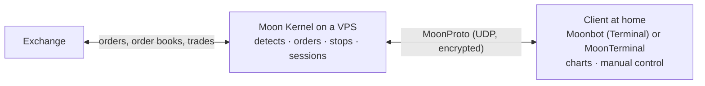

# 07. Moon Kernel, a trading VPS, the control bot and working with exchanges

> **Official Moonbot documentation:** [Moon Kernel](https://moonbot.pro/documentation/menu-button/moon-kernel) | [Recommendations for Terminal Setup for Autotrading on Servers](https://moonbot.pro/documentation/strategy-usage/recommendations-for-terminal-setup-for-autotrading) | [Moonbot for Linux](https://moonbot.pro/moonbot-pro/download/linux) | [Hang Control](https://moonbot.pro/documentation/settings-advanced-tab/hang-control) | [Connecting to the Hyperliquid exchange](https://moonbot.pro/documentation/settings-login-tab/connecting-to-the-hyperliquid-exchange)  
> **Related sections:** [01. Coin selection and filters](01-market-selection-and-filters.md) | [06. Orders, take-profits and stops](06-orders-exits-and-stops-cascade.md) | [08. Testing and debugging](08-testing-debugging-and-analytics.md) | [Reference: exchange error codes and log entries](../reference/exchange-errors-and-logs.md) | [Reference: the MoonCMD protocol](../reference/mooncmd-udp-protocol.md)

---

## 1. Why a trading bot needs a server and what is computed on it

Scalping a spike is a race for a second: the limit order must get into the order book before the available liquidity is consumed, and the stop must fire before the price has gone further. A home computer loses this race not on CPU but on distance: the signal to the exchange's matching engine and back travels through the provider, and every order carries this delay twice. Add the home network and electricity — with an open leveraged position, a connection loss means a trade left unattended.

That is why round-the-clock autotrading in Moonbot is built on two machines: the **kernel** on a server next to the exchange trades, the **client** at your home displays and controls. The terminal itself is a Windows program; on the server an ordinary VPS is enough (the site recommends at least two cores and two gigabytes of memory for a VDS), switched into the economical **VDS optimized mode** (`Menu → System settings`, restart required). The rule is simple: one Moonbot — one VPS.

### The ping that matters

In a client connected to the kernel, latency is shown as two numbers — for example `Kernel: 133 / 25 ms`. The first is the path from you to the kernel, the second is the order's path from the kernel to the exchange. Trading is determined by the **second** number: it decides how fast orders are placed and stops fire. The first is the delay of your manual actions (a click in the order book, a cancel, a strategy edit) and of the picture; the kernel's automation does not depend on it. So a server is chosen by proximity to the exchange's data centers, and the ping is checked not once at setup but periodically — routes and network load change. For fast strategies the site advises a plan with a guaranteed CPU rather than "best effort": in the moment of a market storm an oversold host gives its resources to others exactly when the bot has to process an avalanche of trades.

### Kernel and client: who does what

The kernel (the **Kernel (VPS)** checkbox in the `Moon Proto` window, opened via `Menu → Moon Kernel`) holds the connection to the exchange, receives trades and order books, calculates filters and detects of **all ticked strategies** — regardless of `AutoBuy` — places and re-places orders, manages positions by take-profit, stop and trailing, stores sessions and triggers. The client (the **Terminal** checkbox) draws charts and order books, takes your clicks and strategy edits and passes them to the kernel. The client's access to the kernel is protected by a key (`New Key` on the kernel → `Copy Key` → `Paste Key` on the client); commands and private data go over UDP encrypted; only public reference data — the market list and candles — is transmitted in the open. The functionality is available in PRO and in Free with the MoonBonus module.

What follows from this for the trader:

- **A closed laptop stops nothing.** Strategies, stops and trailing live on the kernel; the client can be switched off at any moment. On the next connection the kernel itself sends the current orders and state. Trades made by the kernel without the client do not get into the client's report — look at the report for them on the kernel.
- **The source of truth is the kernel.** Enabled a strategy from one client — it is enabled on the kernel and on all other clients; strategy edits go to the kernel and from there to everyone. Several clients can be connected to one kernel — the classic Moonbot and the cross-platform [MoonTerminal](https://github.com/Moonbot-Tech/MoonTerminal) at the same time.
- **The kernel is always ready to trade.** At startup and after settings are applied from the client, it enables autostart, autodetect and strategies by itself. The Moonbot client cannot create manual pending orders from the chart in kernel mode — for a conditional entry use a strategy with `BuyStop` / `BuyLimit` ([chapter 06](06-orders-exits-and-stops-cascade.md)).
- **Updating from the client updates everything.** Launching an update on the client updates the kernel and all connected clients — the terminal and kernel versions do not diverge.
- **Time zones must match** on the kernel and the client, otherwise the funding time on the client shows as zero.
- **The Pencil in the pair draws on the kernel**, and what is drawn is seen by all the kernel's strategies — more on this in [chapter 08](08-testing-debugging-and-analytics.md).

### Full Proxy: does the client go to the exchange itself

The client has a **Full Proxy** checkbox, and the site recommends ticking it. With it, the client does not address the exchange at all: everything that concerns the exchange is done by the kernel, and the client receives a ready picture — so the client's API keys do not need an IP white list, and it can be opened from anywhere. Without the checkbox the kernel still manages all orders, but the client loads charts, leverage and market deltas from the exchange itself — this offloads the channel to the server at the cost of its own connections to the exchange from the home IP.

### When the provider cuts UDP: V0 / V1 / V2 masking

The stream between the kernel and the client goes over UDP, and some providers choke such traffic after the first packets: the client connects, loses the kernel within seconds and connects again. The sign is that the received-packet counter `R` on the `Info` tab grew on the first attempt and no longer changes. For such channels the `Moon Proto` window has the `V1` / `V2` masking modes (the site recommends `V2` right away). The mode must be the same on both sides, and it must be changed **first on the kernel** — together with a new port number — **then on the client**. The kernel recognizes such blocking itself and offers to enable masking in the Problems window (section 2).

### Ports: each channel has its own

The kernel's UDP port (`Port` in the `Moon Proto` window) must be open in the server's firewall and, if the provider requires it, in its security panel; the opening can be checked with the `Test Port` button. This port must not coincide with any other UDP port of the bot itself: the `Listen UDP port` for receiving signals (`Settings → Advanced → System`), the MoonCMD UDP command port, the Moon Streamer server port and the control bot port. When they coincide, the kernel does not come up, and the client knocks endlessly on a closed door — the Problems window names the setting that has taken the port.

---

## 2. The server under load: what gets in the bot's way and how it shows

In a calm sideways market the server is almost idle. But when Bitcoin breaks into a sell-off, the flow of trades and order book updates grows simultaneously across all hundreds of pairs, and any extraneous load — an antivirus, a Windows update, a "memory optimizer", an oversold host — takes the CPU away in the very second when the bot has to move a stop. That is why a trading VPS is not set up like a workstation.

### What the product recommends for the server

From the page on setting up the terminal for autotrading on servers: enable **VDS optimized mode** — less memory and CPU goes to storing and drawing charts, more is left for the algorithms; set a **fixed page file of 4096 MB** (the `Set PageFile` button there); set up Windows auto-logon and Moonbot autostart at boot, so that after a server reboot the bot comes up by itself; **disable Windows Update and Windows Defender** — otherwise the system will close the terminal in the middle of an update, and the orders will remain on the exchange without control; disable the daylight saving time switch or set the UTC time zone.

### The Problems window: the first place to look

The terminal itself watches the machine, the network and the exchange and puts what it finds into the **Problems** window (an icon in the status bar). It finds a running "memory cleaner" (such a program periodically pages the bot's memory out to disk — by users' logs each page-out freezes the bot for 0.5–1.4 seconds), Defender and Windows maintenance running on a VDS, auto-updates not switched off, an oversold host that denies the virtual machine the CPU for seconds, a shortage of memory, a provider's UDP blocking between kernel and client, an occupied kernel port, an exchange address that does not resolve, the exchange refusing connections or subscriptions from this IP, an unsigned permission on Hyperliquid, the exchange putting the account into "close-only" mode, a regional block. Each entry contains a verdict and an action. If the bot behaves strangely, open this window first, not the log.

### Time, delays and autostops

The bot accounts for the difference between its clock and the exchange's clock itself, so a small desync does not break signed requests. But keep time synchronization on the server enabled: by the clock the bot measures the lag of the data stream (the `MaxLatency` filter, [chapter 01](01-market-selection-and-filters.md)) and the delay of signals, and by it it writes the log.

On the `Autostart` tab there are two protections the site advises enabling on a server: **autostop on API errors** (the recommended threshold is three to four errors, restart no earlier than 20 minutes later) and **autostop on ping** (a threshold from 100 ms upward depending on the server). The API overload protection works separately: when the bot approaches the exchange's request or order limits, new orders are not placed for a while — in the log this is `New Order won't proceed due to API or CPU overload`. It should not be disabled: with the protection off, support is not provided.

For fast strategies — `MoonShot` with a short corridor, `MoonStrike`, `Drops` with a small price drop — the site recommends a non-zero **`HFT`** (the `Buy conditions` tab): this is the order-placement request validity window in milliseconds. If the command reached the exchange late — for example, the server's ping jumped — the exchange can reject the stale request, and you will not enter "a different market". This window does not cancel an order already accepted by the exchange. The example from the site: on servers with a 10–20 ms ping they set `HFT = 100`, and raise it to 200–300 on rejections. A rejection by `HFT` is a routine event, the bot reports it in Telegram, and the `-1021` error in the log with `HFT` enabled does not count as an API error.

### Moon Streamer — for manual trading, not for the server

Moon Streamer (`Menu → Moon Streamer`, a PRO module activated for Moon Credits) is accelerated chart transmission from a server in Tokyo to the home computer for when, because of exchange lags, trades disappear from the local chart. It is needed for **manual** trading on a local machine. On a trading VDS with autotrading it is not required and, by the site's warning, may interfere with the terminal's operation.

### Linux: two different routes

The site publishes **Moonbot for Linux** — a self-contained container with the Windows version of the terminal under Wine. It needs a graphical desktop environment; Debian 12 is recommended (Ubuntu 20.04–24.04 and RHEL 9-based systems are also verified). This is a way to run the **ordinary windowed terminal** on a Linux machine. An important limitation from the same page: new versions of the bot do not work under Wine, it must not be updated there, and after an accidental update — roll back with the `./MoonBot -R` command.

The second route is the **native windowless kernel for Linux**: the same Moonbot built as a systemd service, always in VDS mode, controlled from an ordinary Moonbot for Windows via MoonProto just like a kernel on a Windows server. The verified system is Ubuntu 24.04 x86-64; no graphical shell is needed on the server. It is installed by the **`VPS setup`** wizard from the Windows bot's main menu: over SSH the wizard transfers the settings to the server — the exchange, API keys, strategies, emulator mode — installs the service with autostart and hands back a ready connection package for `Paste Key`. The report database, history and recorded charts are not transferred; the server's new IP must be added to the API key's white list on the exchange; the original Windows bot is not stopped meanwhile — you choose the moment of switching. At the time of writing, the wizard installs a **test build** of the kernel; the release of the Linux kernel has not yet gone through the full publication and auto-update cycle. For autotrading on Linux this is the target route; the Wine container remains the option for a windowed terminal on a pinned version.

---

## 3. The control bot (WatchDog): what it does and what it does not promise

Even a good VPS can go down together with its data center, lose the network or go into a reboot at the provider. If at that moment there is a leveraged position on the account and entry limit orders in the order book, a stopped bot will not pull up the stop and will not cancel the orders before a sell-off. For this Moonbot has **stuck position control** (a PRO function, `Settings → Advanced → Hang Control`): a separate Moonbot instance — the **control bot** — on another server, preferably at another hoster, with the API keys of your working accounts in its table. One control bot serves many accounts: on spot — all accounts of the exchange, on futures — one control bot per market; the keys in the table must be from **different** accounts (two keys of one account are marked `duplicate`); the site advises no more than 20–30 keys per control bot — on a mass order cancellation the API load is counted per server IP.

Each entry in the table has three independent switches — three different troubles of the working bot:

| Monitoring option | What counts as trouble | What the control bot does | What is needed for it |
| :--- | :--- | :--- | :--- |
| **O** — orders | The bot is alive, but an entry order is stuck: it has stood longer than `Time` seconds or the price has come closer to it than `Price` % | Cancels such an order — on a live bot too | The `Time, s` and `Price, %` columns in the table |
| **P** — positions | A position on the account not covered by closing orders | Reports in Telegram and, with the `AutoSell` checkbox, sells via its own `SafeGuard` manual strategy | The `P` checkbox, optionally `AutoSell`; exceptions — the `Dont control these balances` list |
| **IP** — heartbeat | The working bot has stopped showing signs of life | Cancels this bot's entry orders | On the working bot — "Control orders of this bot" and the control bot's IP in `Control VDS IP`; on the control bot's server the UDP port from its window is open |

### Position monitoring: closing an uncovered position

Having found a position without a closing order, the control bot does not take it over for take-profit and stop tracking — it **closes it with a limit order slightly worse than the current price** (about 0.1%), after the position has been confirmed over a series of checks, is not covered by closing orders and is not smaller than the minimum lot. The `SafeGuard` strategy is created by itself on the first such sale; it can be configured, and if deleted, it appears again. "Abandoned" for it is **any** position without a closing order: bought by hand on the exchange's website, opened by another bot, your manual trade without a take-profit. Hence the rule for an account under a control bot: keep every position with a closing order or put the coin into the exceptions (by default these include `BTC`, `ETH`, `BNB` and stablecoins). Position control works even with the `Start` button off.

What position monitoring does not guarantee: the `SafeGuard` limit order fills like any other — on a thin market it may not get taken; the reaction comes after a series of checks, not in the same second; in emulation mode the control bot does not close the position but writes about it to the log and Telegram. On Binance Futures the position mode (`Hedge` / `One-Way`) of the control bot and the working bots must match — the closing order goes out with the control bot's own mode, and on a mismatch the exchange will reject it.

### Heartbeat monitoring: only marked entry orders

A working bot with the "Control orders of this bot" checkbox constantly sends the control bot an "alive" signal and marks its entry orders. If there is no signal for ten seconds, the control bot considers the bot down and cancels **its entry orders**: those it has already seen via the account's order subscription — at once; the rest — after reconciling the full list with the exchange, with a hold that grows with the number of accounts down at the same time. It does not touch take-profits and other exit orders — they must close the open positions; nor does it touch manual orders from the exchange's website. A regular shutdown or restart of the working bot raises no alarm: it warns the control bot of its departure itself. The `IPStat` column in the table shows how many bot instances on this account are sending the heartbeat; `Offline` with a live bot means that the control bot's IP is not set on the working bot or the checkbox is not enabled, or the UDP port is closed.

### Conditions without which the control bot does not work

- The control bot's IP is in the white list of the working account's API key; on OKX and Bitget both keys are created with the same passphrase.
- The control bot and the working bot are on the same exchange and platform; on Hyperliquid — on the same trading venue (dex) and **with its own separate API Wallet** for the control bot.
- One account — one entry with the `P` checkbox: two control bots on one position will close it simultaneously.
- In a kernel + client pair the control bot watches the **kernel**, not the client.
- The **"Ignore the order replacing errors"** checkbox (`Settings → Advanced`) — on the working bots and on the control bot. Its meaning: if a request to the exchange broke off and the order's fate is unknown, the bot does not search for it for long but counts the attempt as failed and moves on, leaving the lost order to the control bot. Without it, the working bot and the control bot may close one position together. On Binance Futures and Hyperliquid the same checkbox enables order re-placement in a single request.
- The global emulation mode on the control bot is off.
- The main and backup servers are at different hosters: an availability zone failure or an account block at a provider must not switch off both.

---

## 4. Exchanges: request limits and built-in protections

Each exchange has its own protection against order spam, and it counts limits per account and per IP. Hence the basic infrastructure rule: **one trading bot — one IP**. Several bots, control bots and terminals from one address share one limit of connections and subscriptions; when it is exhausted, the exchange refuses the connection, and some functions are left without data — the Problems window shows such a refusal as a separate entry.

### Binance Futures: Quantitative Rules

The exchange restricts accounts that place many orders without fills (response `-4400`), and its response does not show whether the coin or the whole account is restricted. Moonbot has its own pre-protection **`Quantitative Rules`** (`Settings → Advanced`): the bot counts how many orders it has placed on each coin over the last minutes, and the more coins stand with orders at the same time, the lower the allowed ceiling per coin. On exceeding it, the coin goes into quarantine for 11 minutes: no new orders are placed on it, and an already standing `Buy` may be cancelled by the filter re-check (for `MoonShot` always, for the others with `CheckAfterBuy`). This is a terminal heuristic, not an exchange rule: it knows only its own bot's orders — on an account with several bots their orders are not added up — and gives no immunity from account restrictions. Before a listing, disable unneeded coins in advance, at least 11 minutes before. Binance Futures receives order re-placement in a single request only with the "Ignore the order replacing errors" checkbox enabled.

### Bybit, OKX, Gate, Bitget

On **Bybit** an order re-placement — buy and sell — is done in a single request (`Amend`) instead of the "cancel + new placement" pair: half as many operations in the limit and no instant when the order is absent from the order book. On **OKX** the market stop is not supported — the stop always goes as a limit `Panic Sell`; on a "price out of the allowed range" rejection the bot takes the boundary from the exchange's response and places the order inside the corridor, pulling the price toward the last trade with each attempt. On **Gate** the exchange cuts the order limit for accounts with a large share of cancelled orders; on such a response the bot itself sets a global pause of ten minutes, and the strategy parameter `IgnoreGatePenalty = YES` allows a specific strategy not to observe it; on Gate Futures a limit order that has deviated too far from the mark price is rejected (`PRICE_TOO_DEVIATED`); the bot pulls the price into the corridor itself, but a deep `Panic Sell` there is more reliable as a market one with `UseMarketOrder = YES`. The market stop is supported on Binance, Bybit, Gate and Bitget; on OKX, HTX and Hyperliquid the stop goes as a limit cascade ([chapter 06](06-orders-exits-and-stops-cascade.md)).

### Hyperliquid: signing, keys and quota

Hyperliquid is an exchange on its own blockchain: every placement, re-placement and cancellation of an order is a signed transaction. It is signed by the `secp256k1.dll` library from the bot's folder; without this file trading on Hyperliquid is impossible — do not lose it when copying the folder. Before the first trade, the owner wallet once confirms the builder fee permission on a page the bot opens itself; this cannot be done with an agent key.

**API Wallet.** The bot works through an agent key (`API Wallet`) to the main wallet. By the exchange's rules an account has one unnamed and up to three named keys (plus two named ones per sub-account); a new unnamed key **replaces** the previous unnamed one, a key with the same name replaces its namesake, and a key's validity is limited (no more than 180 days). So creating a key "for the second bot" without a new name disables the key of the running one. Moonbot's rule is stricter: **one bot process — one API Wallet**, including the control bot. Two processes on one key throw off each other's transaction counters, and the exchange starts rejecting requests.

**Request quota.** Instead of per-minute limits, Hyperliquid has a cumulative action budget per address: a starting reserve of 10,000 requests plus one request for every USDC of real turnover. The quota does not reset on a timer — every action spends it, and it is replenished by trading turnover or by buying requests on the exchange. `MoonShot` on dozens of coins, moving orders for hours without trades, eats up the reserve. The end of the quota is the most dangerous: cancellations have their own, wider limit, while placement spends the common one — re-placing the take-profit via cancel and new placement removes the take-profit and does not place a new one, **the position is left without a closing order**. So Moonbot watches the remainder itself: when the forecast drops below the reserve (on the order of ten requests per active order plus a margin), it cancels buy orders, stops the strategies and sends a link where to trade up or buy more requests. The quota can be replenished by turnover or by buying requests; compare the full costs — the venue's fee, the spread and the chosen market's contribution to the quota (markets with a discounted fee also give a smaller contribution to the quota).

**IP and venues.** The exchange limits the number of unique addresses whose events can be followed from one IP (ten, by the exchange's documentation); this limit includes bots, control bots and every address from `WatchAddress` of `Watcher` strategies. When the limit is exhausted, the exchange may reject a new subscription — the Problems window shows this as an entry about subscribers on one IP; look at which address and channel were rejected: if it is the subscription to your own account's events, the bot loses those events. Keep one Hyperliquid bot per server. Besides the main market, Moonbot trades on `HIP-3` standard venues and on `HIP-4` prediction markets; the venue is switched with the `HL: …` button in the top panel, the venue list comes from the exchange. The control bot and the working bot must be on the same venue.

---

## 5. Summary cheat sheet

| Task | Rule |
| :--- | :--- |
| **Server** | One Moonbot — one VPS and one IP; close to the exchange, with a guaranteed CPU; VDS optimized mode, a fixed page file, auto-logon and autostart; Defender, Windows updates and the daylight saving switch disabled; no "memory cleaners". Watch the Problems window |
| **Kernel and client** | The kernel trades and calculates all ticked strategies, the client displays; `Full Proxy` on the client; the same key and port, the kernel port does not coincide with the bot's other UDP ports; `V2` masking on both sides when blocked; the same time zones |
| **Linux** | Windowed terminal — the Wine container (pinned version, do not update); autotrading — the native kernel via the `VPS setup` wizard (a test build at the time of writing) |
| **Control bot** | A separate server at another hoster, PRO; the `O` / `P` / `IP` monitoring options are configured separately; `SafeGuard` sells any position without a closing order near the market; the position mode matches the working bots; "Ignore the order replacing errors" on all; emulation off |
| **Binance Futures** | `Quantitative Rules` is a terminal heuristic, not immunity; narrow the coin list in advance before a listing |
| **Hyperliquid** | `secp256k1.dll` in the folder; one API Wallet per process, own key names; watch the request quota — the bot will stop the strategies itself; one bot per IP |
