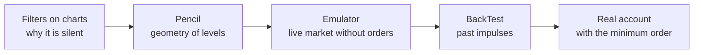

# 08. Testing and debugging strategies: "Filters on charts", the Pencil, the Emulator, BackTest and reports

> **Official Moonbot documentation:** [Emulation Mode](https://moonbot.pro/documentation/menu-button/emulation-mode) | [BackTest](https://moonbot.pro/documentation/menu-button/backtest) | ["Filters on charts" Button (funnel icon)](https://moonbot.pro/documentation/main-terminal-window-with-advanced-settings/funnel-button) | ["Pencil" Button](https://moonbot.pro/documentation/main-terminal-window-with-advanced-settings/pencil-button) | [Main Reports Area with Settings](https://moonbot.pro/documentation/reports-window/main-reports-area-with-settings) | [Log Analyzer](https://moonbot.pro/documentation/menu-button/log-analyzer)  
> **Related sections:** [01. Coin selection and filters](01-market-selection-and-filters.md) | [02. Detects and signals](02-detect-pipeline-and-signals.md) | [04. Triggers and sessions](04-triggers-and-master-slave.md) | [06. Orders, take-profits and stops](06-orders-exits-and-stops-cascade.md) | [07. Kernel and VPS](07-kernel-vps-and-infrastructure.md) | [Reference: log entries and exchange codes](../reference/exchange-errors-and-logs.md) | [Archetype 04. Scout and sniper](../examples/strategies/04-master-slave-scout-and-ladders.md)

---

## 1. What is checked with what

A new strategy almost never works the first time: the sign of an offset is mixed up, the volume ceiling stands at zero, the formula waits for data that is not there yet. Finding this out on a real account is expensive, and waiting for a suitable spike on the live market takes long. In Moonbot each stage of checking has its own tool, and each answers its own question:

| Question | Tool | What it proves | What it will not show |
| :--- | :--- | :--- | :--- |
| Why is the strategy silent on this coin? | **"Filters on charts"** (the funnel icon) | Which filter or pause holds the strategy right now | Refusals at the signal stage and the reason why the impulse did not reach the detect threshold |
| How will the strategy handle a spike of the needed shape? | **The Pencil** (the Pen tool) | The geometry of the entry and exits: where the order will stand, where the take-profit, stop, trailing, trigger will fire | Behavior on a real trade feed with a real order book |
| How does the strategy live on the live market? | **Emulation mode** | Filters, detects, strategy links, sessions and formulas on the real trade stream | The queue in the order book, partial fills, slippage, network delays |
| How would it have handled a past pump or listing? | **BackTest** on `.bin` recordings | The shape and speed of historical impulses, the exit cascade | Everything that reads the order book; liquidations; external signals |
| Where does the strategy earn and where does it give back? | **Reports**, Log Analyzer, the MoonTerminal tuner | The result by coin, time, filter values at entry; execution quality | The trades the strategy skipped |
| Is the strategy to blame at all? | The **Problems** window | What hinders the terminal: memory, network, exchange, keys, agreements | Errors in the strategy logic itself |

The last step cannot be replaced by anything: only a real order shows the queue, slippage and delays that neither the emulator nor the backtest has. The site recommends exactly this order — after the emulator, trade with the minimum order.

---

## 2. "Filters on charts": why the strategy is silent

The **"Filters on charts"** button (the funnel icon above the chart) turns on the output of reasons in the upper left corner of the coin's chart: next to the name of each running strategy — the check on which the coin was cut off, for example `3h delta (14.20%) doesnt match strategy range (0.00% .. 10.00%)`. A right click on the icon opens a menu:

- **Show Filters** — the failure reasons themselves. One line per strategy — the first in the check order; after removing the reason you may see the next one. Details on `EMA` conditions are visible only on a full-screen chart; in a small window the formula is marked with the general "EMA filter not passed" entry.
- **Show Session** and **Hide zero sessions** — the accumulated result of the strategies' sessions on the coin (only for strategies with `IgnoreSession = NO`), without zero lines.
- **Show MoonShot price corridor** — the green corridor in which `MoonShot` keeps its order; you can see how the strategy returns the order to the center as the price moves.
- **Scroll Filters ALT+Wheel** — scrolling the list when there are many strategies.

"Filters on charts" is responsible only for filters and pauses. If there is no line and still no order, there are two causes: the detect condition itself was not met (the impulse did not reach the thresholds), or the refusal happened at the signal stage — the re-check before placing, balance, minimum lot, a conflict with an open position. These refusals are written to the `logs/LOG_YYYY-MM-DD.log` log: the signal line carries the reason (`Max active orders is …`, `Free balance (…) is not enough`, `Newly added coin!!`), and the re-check before placing writes `FilterCheck Before Buy: market no longer meets the conditions`. The order of all checks is in the [reference](../reference/filter-execution-order.md), the life of filters inside a trade — in [chapter 01](01-market-selection-and-filters.md#6-how-filters-live-through-a-trade).

---

## 3. The Pencil: draw a spike and see how the strategy handles it

A strategy for a five-second spike or a cascading sell-off on a calm market can wait for its move for days. The Pencil lets you not wait: draw the price trajectory with the mouse and see how the strategy takes the detect, where it places the order, how it manages the take-profit and where the stop fires.

### How to draw

The **Pencil** button above the chart opens the drawing tools (available in the PRO version). The price is drawn by the **Pen** tool with the **Emulator** checkbox — then the **"Draw as price line"** mode appears, available to MoonBonus program participants. Hold `Ctrl` and draw a line with the left button **to the right of the current price**, with a gap from the last trades. When the chart reaches the start of the line, trades run along it — the drawn trades — and the strategies handle them as real: detect, buy order, fill on crossing, take-profit, stop, trailing, triggers. For a sharp spike it is enough to put a point or a short line below the price — the chart will drop to it.

It is more convenient to draw on a coin with a dense feed (the site advises `BTC`): the drawn line lies more evenly. Before drawing, stretch the chart with the mouse wheel and turn off auto-scrolling so that there is room on the right. Right-click on a figure — delete it, `Ctrl+Z` — undo the last one.

### The drawn price is real for all strategies

The drawn trades get into the coin's feed, and **all** running strategies react to them, not only the one you are checking. The **Emulator** checkbox of the Pen does not check the terminal's mode: if the terminal is in real mode, a live strategy will answer the drawing with a real order at the exchange's real price. So the order is this:

1. First **Menu → Emulation mode** (or a separate terminal for experiments), then drawing. The emulation mode of a single strategy (the "Emulator" checkbox on the `Main` tab) protects only that strategy.
2. In a client + kernel pair (`FullProxy`) the drawing goes to the kernel and merges into the coin's common trade stream for all the kernel's strategies — the global emulation mode is needed **on the kernel**, and before drawing it is worth making sure it has been applied. The kernel does not accept points farther than about a minute from the current moment — draw in short fragments close to "now".
3. After the experiment, **reload the charts** (Menu → Reload charts or the Reload Chart hotkey): the coin's deltas and averages keep carrying the drawn price until the history is reloaded, and the filters on this coin calculate from distorted data. If there is no Load Charts module, the site recommends drawing on a separate terminal.

### Trace: order trajectories on the chart

In the same Pencil menu the **Trace** tool draws the traces of buy and sell orders and stop lines over time — you can see how the strategy re-placed the take-profit and where the stop stood at each moment. The **Opacity** slider sets the transparency, **Trace Clear** clears the traces on the coin opened in full screen. This is faster than reconstructing the re-placements from the log.

---

## 4. Emulation mode: a live market without orders to the exchange

The emulator takes in the real stream of trades, order books, liquidations and deltas, but fills orders inside the terminal: not a single request goes to the exchange, the balance does not change, API limits are not spent. It is both a manual scalping simulator on real quotes and a proving ground for auto strategies: filters, detects, triggers, sessions and `CustomEMA` formulas are checked on the live market without capital.

### Two levels of enabling

| Level | Where | What it switches to emulation |
| :--- | :--- | :--- |
| **The whole terminal** | **Menu → Emulation mode**; after confirmation a red `== EMULATION ==` label lights up to the right of the "Menu" button | All strategies and manual clicks. Switching it off returns real mode at once, without a warning |
| **One strategy** | The **"Emulator"** checkbox on the `Main` tab (in the strategy file `EmulatorMode=YES`) | Only this strategy; the others and manual trading keep working with real money |

Emulator trades are visible everywhere, but marked: in the log and Telegram — `(Emulator)`, on an order on the chart — `(E)`, in the reports — the **"Emulator"** checkbox, which switches the table to virtual trades (they are not shown together with the real ones).

### What the emulator models and what it does not

There is one fill rule: a limit order is considered filled when a market trade has **passed through** its level — and then **the whole size fills at once**. Touching the order price without trading through it does not count as a fill, although on the exchange you might have been filled if you stood first in the queue. An order that already crosses the market when placed fills at the market's best price. The fee is accounted for. Not modeled are the queue in the order book, partial fills, the influence of your size on the order book and network delays — so emulator results look better than real ones, and trades of a large size on a thin order book lie the most. Control the liquidity for your working size with volume filters and `BuyOrderReduce` ([chapter 01](01-market-selection-and-filters.md)).

The size of a virtual order is limited the same way as a real one — by the account balance and leverage: with a zero real balance the order is placed at about one and a half minimum lots (the site: roughly `$15`), with funds available — within the balance. But open virtual positions do **not** occupy the balance: the emulator will not show that on a real account there would not be enough margin for all these positions at once. Assess the total load of a grid or a strategy link from the reports yourself.

Two things cannot be checked in the emulator: joining take-profits by `JoinSellKey` (virtual orders are not merged — a link with a common key works only on real orders, [chapter 04](04-triggers-and-master-slave.md)) and the `DontSellBelowLiq` / `StopAboveLiq` liquidation protections (they can hold back a virtual exit — switch them off for the duration of tests).

### The Autotrading module and the emulator

Part of a strategy's conditions — the `CustomEMA` and `SellByCustomEMA` formulas, triggers, strategy sessions, `MShotRepeat*` repeat shots, the `Spread`, `EMA`, `Activity` detects — work with the **Autotrading** module (PRO) **or in the terminal's global emulation mode**. The "Emulator" checkbox of an individual strategy does not replace the module. Hence the trap: a "master → slave" link works perfectly in the emulator, while on a real account without the module the conditions are silently skipped — the slave enters without the master, the shield does not block. Check a strategy in the same access configuration in which you are going to trade. In Free the orders are real, and their number is limited (up to `30` active).

### A scout in the emulator and how it touches live trading

An emulator strategy is often kept as a "scout": it watches the market, catches the first signs of activity and lights the key of a live strategy ([chapter 04](04-triggers-and-master-slave.md), [archetype 04](../examples/strategies/04-master-slave-scout-and-ladders.md)). Its virtual trades are not as harmless as they seem:

- a closed virtual trade **is added to the coin's market session** just like a real one and moves the `SessionProfitMin / Max` of the live strategies on this coin; it also updates the scout's own session;
- a losing virtual trade switches on the `TradePenaltyTime` (after one) and `PenaltyTime` (after three in a row) pauses in all strategies where they are set, and lights `TriggerKeyProfit` / `TriggerKeyLoss`;
- all active orders, including virtual ones, count toward the terminal's common limit — the `Max Orders` field (by default `30`; the **"Unlimited orders"** checkbox allows setting more): a scout on two hundred coins may leave no room for the live sniper;
- the global **"Ignore Emulator Trades"** checkbox (autostop settings) excludes virtual trades **only** from the terminal's common result-based autostops — it protects neither the market session, nor the strategy session, nor the pauses.

The rule: on spot give the scout **`AutoSell = NO`** and `ActiveTrigger = NO` — a virtual buy without a sale completes its task at once, without a take-profit, closing and side effects. On futures `AutoSell` is hidden and forced to `YES`: the scout holds the virtual position until it closes and all that time does not re-arm on this coin — give it closing conditions (`SellPrice`, `StopLoss`) and leave its session thresholds off. A `MoonShot` scout can separately be allowed a repeat shot while the position is still open (`MShotRepeatAfterBuy` with its conditions and repeat window) — this is a repeat entry, not an exit.

---

## 5. BackTest: running a strategy over recorded trades

A loud listing or a cascading sell-off does not happen every day. BackTest plays back a trade recording from a `.bin` file on the chart and lets the strategies handle the past impulse as if it were happening now. The **BackTest** module is available in the PRO version and is activated in the Moon Credits window for `500` MoonCredits; without it the log shows `Need Backtest module!`. The window opens via **Menu → BackTest**.

### Where the recordings come from

- **From the `logs` folder.** The terminal saves the tick chart of **every closed trade** (detects without a trade are not recorded separately) and deletes these files together with the old logs — by default after `7` days (Settings → Advanced). To keep a recording from disappearing, mark the trade in the reports with the **"Important"** checkbox: the file is copied to `Logs\Important` and `BackTest\Important`. Do not keep reference recordings in `logs`.
- **Exchange archives** from the lower zone of the window: exchange, Spot / Futures, day (`Daily`) or month (`Monthly`), coin, date. Available are Binance Spot from August 2017, Binance Futures from January 2020, Gate Spot from January 2018, Gate Futures from November 2019; for Bybit the `.csv.gz` archive is downloaded from the exchange's website by yourself and opened with the **Use Bybit gz** button. The `Not Found` label means a wrong coin or a date with no trading.
- **"Download Examples"** — a selection of volatile episodes from the Moonbot server into the `BackTest` folder.

### The recording plays in real time — hence the Scissors

A minute of recording plays for a minute, a daily exchange archive for a day: there is no acceleration, because it would compress all the strategies' timers. A valuable spike in a daily archive takes minutes, the rest is empty sideways. So the fragment is cut out: the **Eye** button opens the file in the Pump Chart window, the **Scissors** button and `Ctrl` + left button select a segment, the terminal asks for confirmation and saves it as a separate `.bin` in `BackTest`. Two caveats from the site: the empty area before the first trade mark also gets into the file and will be honestly played as silence, and cutting is possible only while the chart is shown as trades — BackTest will not take a file made of mini-candles (`Nothing to play!`). Several fragments of one coin can be played one after another and cut into one file; "splicing" by reopening files of the same coin is an undocumented possibility that requires fragments without gaps in time.

### What in a backtest is historical and what is live

The recording is overlaid on a live market used for replay: the same coin if it is traded, otherwise `ETH` or another free one. The trade prices are scaled to that market's current level, the dollar volume of each trade is preserved, the mark price is played back if it was recorded. Starting turns on the global emulation mode by itself; switching emulation off stops the run. Several selected files play simultaneously, each on its own chart.

The `BTC` and market deltas, all other coins and funding still use live data — the context filters are calculated on today's market, not on the day of the recording. The replay market's order book is **frozen** for the duration of the run in its state at the moment of start; the synthetic order book on the screen is only a visualization. So in a backtest you cannot check what reads the order book: `WallsDetection`, `ChartWall`, the order book confirmation in `Volumes`, `MShotSortBy = OrderBook`, stops and take-profits that depend on order book liquidity. Liquidations are not played back (`Liquidations` is not checked), nor are the external signals `Telegram`, `UDP`, `Watcher`. After the run, reload the charts: the replay market remembers the played prices.

Two runs of one file give different results — this is normal: the detect and the re-placements are recalculated discretely, and each start lands in a different phase of these recalculations, like two bots on neighboring VPSs. A robust strategy gives a plus over a series of runs and on different recordings, not on one lucky tick.

---

## 6. Reports and statistics: what to count as the result

### The Reports window

The **Reports** window holds all the terminal's trades with filters by status (active, closed, with deleted), period (the time and date menus "From" / "To", counting by open or close date), coin and strategy (the **Filter** field; **Filter2** accepts `+` and `−` to keep only profitable or losing ones), direction `Long` / `Short`. The **"Emulator"** checkbox switches the table to virtual trades. A trade's line shows the source (`Manual` / `Automatic` / `Signal`), the strategy and the close reason — `Sell Price`, `PanicSell`, `StopLoss`, `TrailingStop`, `Auto Price Down`, `Sell Level`, `Manual`; a click on the coin opens its chart, the **To strategy BL** / **To global BL** buttons send the coin to the strategy's or the terminal's black list. The comment field keeps the filter values at the moment of entry — volumes, deltas, formula results — and it is from these that statistics are built later.

The `LagTP` column is the delay between the buy fill and the placing of the take-profit: a positive number is calculated from the exchange's timestamps, a negative one from the terminal's clock when the exchange did not send a timestamp. It also includes the deliberate `SellDelay` pause. **Manage Data** cleans the database of old trades; the "Delete Only Emulator" checkbox removes the virtual ones without touching the real ones.

**The Total at the bottom of the window.** The numbers in the bottom line are calculated over all rows of the current selection, not only the displayed ones: `Avg.Order` is the average order size (the sum of sizes divided by the number of rows), the percentage next to it is the profit relative to the sum of sizes, and `Total %` is the profit in units of one average order, **not the growth of the balance**. An example without leverage and funding: `61` rows, sizes totaling `2070 $`, profit `14.27 $` → the average order `33.93 $`, next to it `+0.69%`, `Total +42.1%`. The `Avg. order with Leverage` switch changes whether the size is taken with leverage; funding rows count toward the number of rows and the profit but not toward the sum of sizes; for open trades the current valuation counts toward the profit. When comparing strategy variants, align the selection: filters, period, closed and open, real and emulator, leverage mode.

Sessions are a separate cut of the result: a coin's market session adds up everything that closed on the coin (including the emulator), a strategy's session — only its own trades. How they switch on pauses and change the order size is in [chapter 04](04-triggers-and-master-slave.md).

### Log Analyzer: execution quality from the log

**Menu → Log Analyzer** parses **one selected** `logs/LOG_YYYY-MM-DD.log` log file and outputs: the number of signals, the number of orders — emulator and real separately, and for the real ones the details: how many orders filled during a re-placement, the `Avg Orders simultaneously` indicator (in the current version this is the sum of task lifetimes, not the average number of standing orders — do not use it to assess load), the average order lifetime, the average number of upward and downward re-placements and their total number. This answers the question "am I losing profit on slow take-profit placement and idle re-placements" — ask it on the VPS, not on the home PC. The filled orders of the coin opened in full screen are printed to the log by the **Orders History** command.

### The strategy tuner in MoonTerminal

In MoonTerminal the **"Analytics" → "Strategy Tuning"** window lays the trade database out along four axes: **by filter** (the distribution of profitable and losing trades by the indicator's value at entry and a recalculation of the result when a range is cut off), **by coin**, **by time** (hours and days of the week — the basis for `WorkingTime` / `WorkingWeekTime`) and **entry / exit** — a replay of the recorded feed around each trade with different exit and stop parameters. Two limitations to keep in mind:

1. The tuner works **only on trades that happened**: it will honestly say what a deeper entry or a different take-profit would have given, but it will not show the trades the strategy skipped. A variant with a closer entry is therefore understated — the spikes the real order did not reach did not get into the report. The entry is modeled only for `MoonShot`; for the other types the exit and stops are iterated.
2. The "by filter" cut checks the number saved in the report directly, while the live filter can be composite: `Delta_3h` and `Delta_24h` also take the hourly delta into account, `MarkPrice` reads the sign relative to the trade direction, `BinancePriceBug` holds a pause after a burst. Re-check the found boundary against the meaning of the filter from [chapter 01](01-market-selection-and-filters.md).

The tuner has a built-in hold-out check: the selection learns on one part of the history and is checked on another. Trust the variant that is no worse than the fact on the held-out part too.

### Protection against fitting to history

There is one rule: a filter boundary must have market meaning, not a pretty figure. "Entries on low-volume coins are losing because in an empty order book my order gets smeared by slippage" is a restriction that will survive the next month. "Cut out a narrow strip of delta where two stops happened to land last week" is self-deception. Draw conclusions on a sample collected across different market phases, and check the edit on data that did not take part in the selection. A smooth curve in the emulator and the backtest does not prove profitability: the next step is the same set of strategies on a real account with the minimum order.

---

## 7. The Problems window: when the strategy is not to blame

Some of the causes of "the strategy does not trade" lie outside the strategy: the exchange does not accept orders until an agreement is signed; the API key has died; the VPS pages the bot's memory out to disk; the provider's filter tears the stream to the kernel. The terminal runs its own diagnostics of such states and shows them in the **Problems** window — it opens by clicking the warning in the status bar at the bottom of the main window. Each entry is a verdict in plain language plus technical details; only states confirmed by a series of observations are shown.

What the window can recognize:

| Group | States |
| :--- | :--- |
| **Machine** | A "memory cleaner" process; the bots are cramped in the machine's memory; the bot's memory goes through the disk; the hypervisor denies the virtual machine CPU time; Microsoft Defender, Windows maintenance or auto-updates are running on the VDS (and not disabled); the previous session ended abnormally; a video driver failure; interface timer delays |
| **Network** | `MoonProto` losses and reconnections above normal; the provider's DPI or UDP filter tears the stream to the kernel; the kernel port is occupied (usually the same port is entered in another UDP setting); the channel to the exchange is broken — a series of TLS errors and timeouts; the exchange address does not resolve (DNS); the exchange refuses WebSocket connections — the connection limit per IP; Binance has blocked the IP until the specified time for exceeding request limits; Hyperliquid does not subscribe to order events — more than ten users from one IP |
| **Exchange and account** | The exchange rejects the API keys; the exchange blocks the region or IP (`HTTP 451`); an agreement has not been accepted — TradFi, pre-market, risk disclosure for a coin (accepted only on the exchange's website); the pair is forbidden for the account ("symbol is not permitted"); Gate has forbidden the market by a risk check; the account (`-4087`) or the coin (`-4106` / `-4107`) has been put by the exchange into "close-only" mode; Bitget has restricted the account's operations; on Hyperliquid the builder fee permission has not been granted — without it the bot does not trade; access to the referral link denied |

If the strategy is silent across the whole market or orders are rejected with the same error, look here first, then at "Filters on charts". The decoding of specific exchange codes and log lines is in the [reference](../reference/exchange-errors-and-logs.md).

---

## 8. Why the strategy does not buy: a check at the terminal level

The strategy's filters are the last cause of silence worth suspecting. Go down the list from top to bottom: each item is a cause, where it is visible and what to do.

| Cause | Where it is visible | What to do |
| :--- | :--- | :--- |
| The coin is not in the terminal's **Coins table** or in the strategy's lists (`CoinsWhiteList`, `CoinsBlackList`, the global black list, dynamic lists) | "Filters on charts": `doesnt match strategy white list` / `Dynamic white list`; the Coins table | Check the lists and masks (`*UP` also cuts `JUP`); for a dynamic list — both `DynWL_Count` and the filters it is built from |
| The strategy is not ticked or not running; the first line in the file is not `Active=0` / `Active=-1` | The strategy list; on import — `Strategy file format error (Active field)` | Tick and run; import the strategy with `Active=0` |
| The strategy type is unavailable without a module or license (`MoonHook`, `MoonStrike`, `Liquidations`, `Watcher`, `ChartWall` and others), or a strategy condition (`CustomEMA`, triggers, sessions) requires the **Autotrading** module and is **silently skipped** without it | The strategy does not start — or enters where it should not (the slave without the master) | Check the access conditions in the [README](../README.md); test in the configuration in which you will trade |
| The terminal's global prohibitions: **"Dont buy newly added coins"** (by default 60 minutes), **"Dont buy delisted coins"** (Settings → Main); `IgnoreFilters` does not lift them | The log; "Filters on charts" for listing strategies | For trading listings, zero the slider and set the pair's age in the strategy (`DontTradeListing` / `OnlyNewListing`) |
| Pauses: `GlobalDetectPenalty` after any detect on the coin, `NextDetectPenalty`, `TradePenaltyTime` / `PenaltyTime` after losses (including emulator ones), the strategy's pause after `BinancePriceBug` and `MaxLatency`, session thresholds | "Filters on charts" (pauses and sessions — Show Session); the log | Wait, or shorten the pause in the strategy that does not need to be held back; for a scout on spot — `AutoSell = NO` |
| The coin did not pass the filters — volume, deltas, `BTC` / market context, price step, tags, funding, `MarkPrice`; a zero in `MaxVolume`, `MaxHourlyVolume`, `Delta_*_Max`, `PriceStepMax` is read as a ceiling of `0` | "Filters on charts": the first failed check | Check the boundaries against the Coins table; replace zeros with wide boundaries or disable the group with `Ignore*` |
| After a restart the filters and formulas have no history yet (`MinHourlyVolFast`, deltas, `EMA` / `Avg`) | "Filters on charts": zero values; for formulas — no data | Wait for the history to accumulate; this is not a failure |
| The filters passed, the detect condition is not met or a refusal at the signal stage (the re-check, balance, minimum lot, an opposite position, `MaxPosition`) | "Filters on charts" is empty; the log: the signal line with the reason, `FilterCheck Before Buy: …` | Read the log; with `DontCheckBeforeBuy = NO` remember the second check |
| The order was placed and cancelled: `CheckAfterBuy` (for `MoonShot` always) when the coin left the filters; `AutoCancelBuy` on the timer | The log: `FilterCheck: market no longer meets the conditions`, auto-cancel; the reports | Widen the `DeltaSwitch` hysteresis, reconsider `AutoCancelBuy` |
| The terminal's common active order limit is exhausted (`Max Orders`, by default `30`, counting virtual ones) or the Free limit (`30`) | The log: `Max active orders is …`; the number of standing orders | Raise `Max Orders` (the "Unlimited orders" checkbox is needed) or narrow the scout's coin list; check the Free conditions |
| Coin quarantine by `Quantitative Rules` (Binance Futures, 11 minutes) or the Gate order limit | The log: `...will be blackListed for 10 minutes`; the [reference](../reference/exchange-errors-and-logs.md) | Narrow the list of coins with orders in advance before a listing |
| No balance or margin, the position limit at the current leverage exceeded, the order outside the exchange's price corridor | The log: `insufficient balance`, `Exceeded the maximum allowable position`, `-4016` / `-4024`; the Problems window for "close-only" | Reduce the leverage or size; `UseMarketOrder` for stops; see [chapter 06](06-orders-exits-and-stops-cascade.md) |
| The exchange does not accept orders on the account: the agreement is not signed, the key is rejected, the region is blocked, the pair is forbidden for the account | The **Problems** window; the log | Meet the requirement on the exchange's website; check the keys and IP |
| In a kernel + client pair the strategy is ticked not where the detect is calculated | The client only displays; the detect of all ticked strategies runs on the kernel | Check the strategy list on the kernel ([chapter 07](07-kernel-vps-and-infrastructure.md)) |

If the list has been gone through and there is no answer, one reliable means remains: draw the needed spike with the Pencil in emulation mode and see at which step the strategy stopped.
