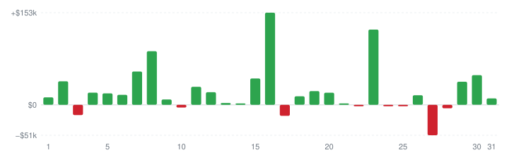

# Moonbot public trading statistics archive

Aggregated anonymized trading telemetry from [`stat.moonbot.pro`](https://stat.moonbot.pro/) since March 2019 (statistics sent voluntarily by participants of the public rating).

- **Total tracked volume (March 2019 – November 2026):** `$165 113 711 350` (`$165.11 billion`)
- **Total filled orders:** `205 622 957` (`205.62 million`)
- **Current monthly snapshot:** [`stats/2026-11.md`](2026-11.md)

> The month file `stats/YYYY-MM.md` is updated while the month is current. After the month changes it is no longer appended and stays as of its last update: the last days of the month may be missing from it. The table below re-reads the monthly totals from [`stat.moonbot.pro`](https://stat.moonbot.pro/) on every update; the full daily data is there as well.

## Last 12 months

| Month | Trading volume, $ | Filled orders | Active markets |
| --- | --- | --- | --- |
| November 2026 | `$12 400 295` | `20 368` | `116` |
| October 2026 | `$1 019 796 952` | `1 561 931` | `234` |
| September 2026 | `$1 378 946 958` | `1 803 380` | `231` |
| August 2026 | `$1 418 669 807` | `1 589 519` | `223` |
| July 2026 | `$870 851 340` | `1 733 426` | `213` |
| June 2026 | `$1 390 033 760` | `1 775 917` | `215` |
| May 2026 | `$1 013 695 489` | `1 678 354` | `221` |
| April 2026 | `$1 375 291 202` | `2 246 773` | `239` |
| March 2026 | `$1 149 518 449` | `1 353 426` | `247` |
| February 2026 | `$1 215 254 201` | `1 540 021` | `253` |
| January 2026 | `$1 352 850 673` | `1 914 960` | `255` |
| December 2025 | `$1 145 215 090` | `2 091 582` | `278` |
